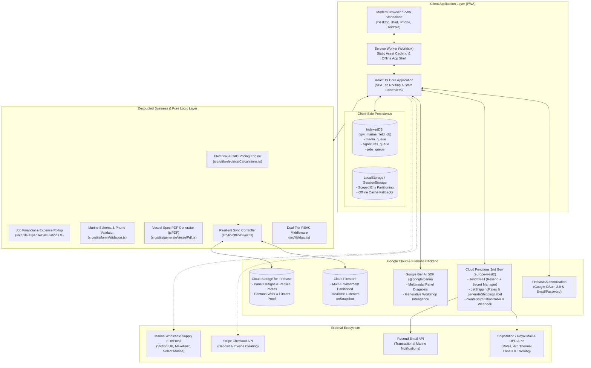
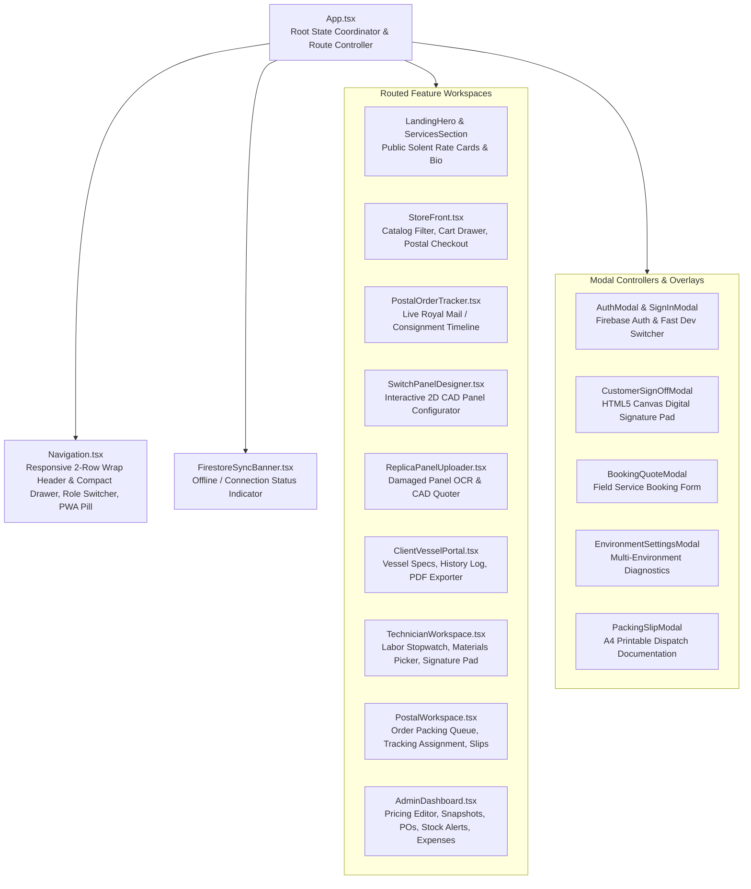
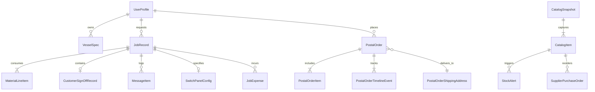
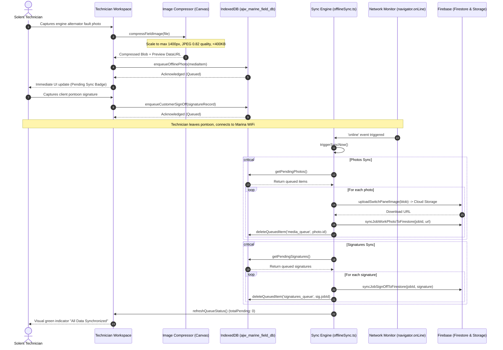
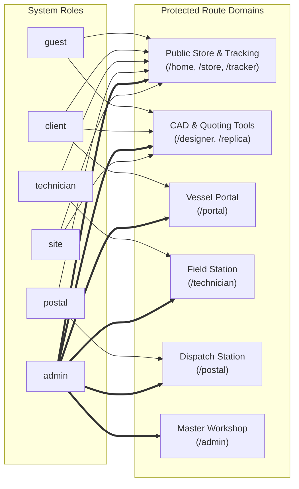
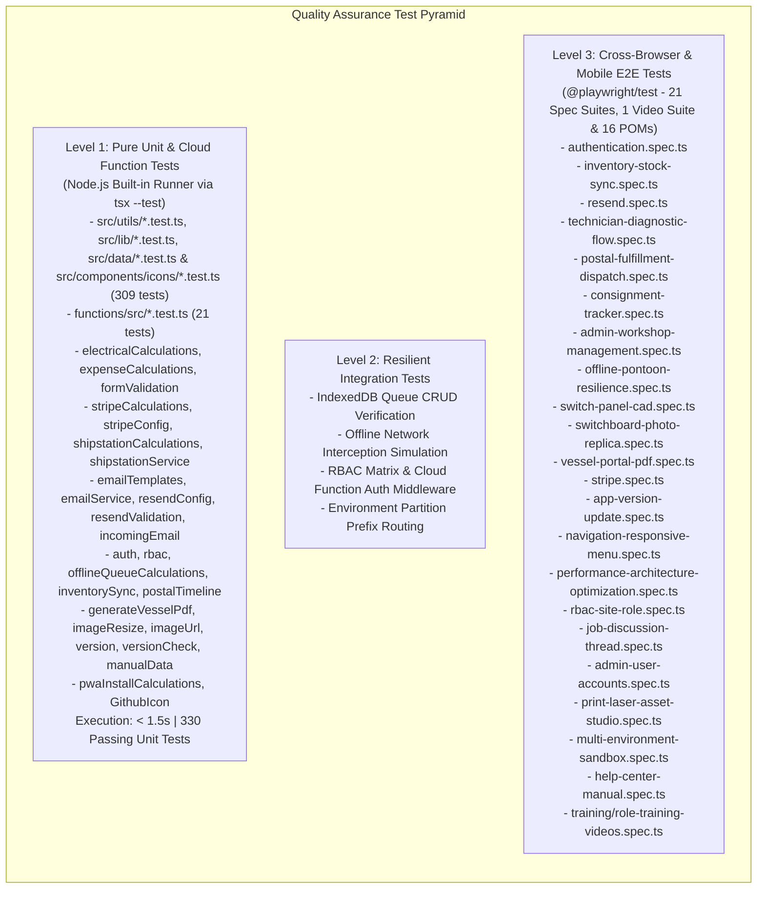
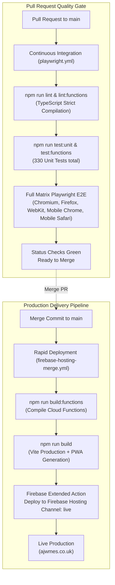

# AJW Marine Electrical Services — System Architecture & QA Design Specification

> **Document Classification:** Engineering Architecture & Quality Assurance Specification  
> **Author:** Principal Full Stack Engineer & QA Automation Specialist  
> **Application Version:** `0.0.1` (Proof of Concept) | **Target Runtime:** Node `>=24.12.0`  
> **Repository:** `ajwmes/ajwmes` | **Primary Domain:** [ajwmes.co.uk](https://ajwmes.co.uk)  
> **Last Updated:** October 2026  

---

## Table of Contents
1. [Executive Summary & Operational Domain](#1-executive-summary--operational-domain)
2. [High-Level Architecture & System Topology](#2-high-level-architecture--system-topology)
3. [Core Design Principles & Tenets](#3-core-design-principles--tenets)
4. [Frontend Architecture & Component Hierarchy](#4-frontend-architecture--component-hierarchy)
5. [Data Models & Firestore Schema Architecture](#5-data-models--firestore-schema-architecture)
6. [Offline-First Engine & Field Data Synchronization](#6-offline-first-engine--field-data-synchronization)
7. [Security Model, Authentication & Dual-Tier RBAC](#7-security-model-authentication--dual-tier-rbac)
8. [Domain Business Logic & Calculation Engines](#8-domain-business-logic--calculation-engines)
9. [Progressive Web App (PWA) & Mobile Field Performance](#9-progressive-web-app-pwa--mobile-field-performance)
10. [Comprehensive QA Automation & Test Strategy](#10-comprehensive-qa-automation--test-strategy)
11. [CI/CD Pipelines & Operational Deployment](#11-cicd-pipelines--operational-deployment)
12. [Architecture Decision Records (ADRs)](#12-architecture-decision-records-adrs)

---

## 1. Executive Summary & Operational Domain

**AJW Marine Electrical Services (AJWMES)** is a specialized marine electrical engineering Progressive Web App (PWA) and workshop operations platform headquartered in Gosport, Hampshire, serving the Solent marine basin (Portsmouth, Southampton, Hamble, Cowes, and Chichester).

### 1.1 Operational Pillars
The platform unifies five core operational capabilities:
1. **On-Vessel Diagnostic Workstation**: Field technician portal for managing jobs, timing diagnostic labor at a flat £25/hour rate, tracking marine materials used, recording vessel faults, and capturing pontoon customer digital signatures offline.
2. **Marine Hardware & Postal Fulfillment Station**: Storefront for marine-grade tinned copper conductors, Victron Energy equipment, Blue Sea Systems switchgear, and terminal consumables with an automated workshop packing queue, dispatch management, and Royal Mail / DPD tracking integration.
3. **Custom Switch Panel CAD Configurator & Replica Quoter**: Interactive design studio for custom switch panels (acrylic and teak), cut-out dimensioning, circuit rating assignment, and photographic replica extraction for boat refits.
4. **Boat Owner Vessel Electrical Portal**: Digital vessel logbook storing 12V/24V electrical specifications, LiFePO4 lithium bank capacities, solar array outputs, wiring schematics, and PDF certificate generation.
5. **Master Workshop Management**: Administrative back-office for inventory control, automated zero-stock alert emails, supplier purchase order drafting (MakeFast, Solent Marine, Victron UK), expense classification, and laser cut file exports.

---

## 2. High-Level Architecture & System Topology

The system uses an **Offline-First Single-Page Application (SPA) / Progressive Web App (PWA)** architecture built on React 19 and Vite 8, backed by Google Firebase serverless cloud services and Google Gemini Generative AI.



---

## 3. Core Design Principles & Tenets

### 3.1 Offline-First Resiliency on the Pontoon
Marine electrical diagnostics routinely occur inside steel hulls, GRP engine bays, or offshore pontoons where cellular signal is nonexistent. 
- **Tenet**: *No technician action may ever be blocked by a dropped network connection.*
- Mutations are committed instantaneously to local state and queued in durable IndexedDB stores.
- Firestore operations are wrapped with graceful fallbacks; code 14 (`UNAVAILABLE`) is handled silently without interrupting technician workflows.

### 3.2 Multi-Environment Data Scoping
To enable concurrent development, staging previews, and live production within a single Firebase project without cross-contaminating production marine data, all collections are scoped dynamically:
- **Tenet**: *Collection isolation is guaranteed by deterministic environmental prefixes.*
- Dev Workspaces: `ais_dev_*`
- Shared PR Previews: `ais_pre_*`
- GitHub Staging: `gh_pre_*`
- Production Live ([ajwmes.co.uk](https://ajwmes.co.uk)): Root collections (`jobs`, `catalog`, `postal_orders`, `users`).

### 3.3 Strict Separation of Pure Logic and UI Components
All mathematical calculations (Ohm's Law, voltage drops, diagnostic hourly rates, fractional labor, panel layout geometry, material costs) are strictly decoupled from React rendering cycles:
- **Tenet**: *Calculations are pure, deterministic functions located in [`src/utils/`](file:///Users/anthonywrather/Documents/Projects/ajwmes/ajwmes/src/utils) accompanied by unit tests.*

### 3.4 Defense-in-Depth Authorization
Security is enforced at two distinct boundaries:
1. Client-Side User Experience: Dynamic route masking and action execution interception via [`src/lib/rbac.ts`](file:///Users/anthonywrather/Documents/Projects/ajwmes/ajwmes/src/lib/rbac.ts).
2. Server-Side Data Integrity: Strict default-deny Firestore Security Rules ([`firestore.rules`](file:///Users/anthonywrather/Documents/Projects/ajwmes/ajwmes/firestore.rules)) with document ID validation and regex prefix matching.

---

## 4. Frontend Architecture & Component Hierarchy

### 4.1 Technology Stack Rationale

| Layer | Technology | Version | Architectural Justification |
| :--- | :--- | :--- | :--- |
| **Framework** | React | `19.3.0` | Concurrent rendering, modern hooks, fine-grained state reactivity without boilerplate overhead. |
| **Language** | TypeScript | `7.0.2` (Strict) | Compile-time guarantees for electrical safety calculations, schema enforcement, and zero `any` allowance. |
| **Build Tool** | Vite | `8.3.4` | Sub-second Hot Module Replacement (HMR), optimized Rollup chunking, and instant cold starts. |
| **Styling** | Tailwind CSS | `4.3.3` | Next-generation engine (`@tailwindcss/vite`), zero legacy config overhead, nautical palette (`#0A192F` marine navy). |
| **Animations** | Motion | `12.43.0` | Fluid physics-based transitions for modals, switch panel interactions, and progress bars. |
| **PWA Engine** | `vite-plugin-pwa` | `2.0.0` | Workbox service worker generation, offline asset caching, web manifest management. |
| **Icons** | Lucide React | `0.546.0` | Lightweight, scalable vector icons consistent across marine instrument visualizers. |

### 4.2 Component Architecture & State Distribution



### 4.3 Key Component Responsibilities

1. **[`SwitchPanelDesigner.tsx`](file:///Users/anthonywrather/Documents/Projects/ajwmes/ajwmes/src/components/panels/SwitchPanelDesigner.tsx)**:
   - Live interactive 2D preview rendered using SVG/CSS scaling.
   - Dynamic width recalculation based on gang count and cutout specifications (voltmeter, dual USB sockets, 12V marine accessory sockets).
   - Real-time CAD laser cutting quotation matching material (matte black acrylic, gloss white acrylic, oiled marine teak, birch).
2. **[`TechnicianWorkspace.tsx`](file:///Users/anthonywrather/Documents/Projects/ajwmes/ajwmes/src/components/technician/TechnicianWorkspace.tsx)**:
   - Diagnostic Stopwatch with millisecond precision, clamping negative values, and rounding to billable fractional hours.
   - Rapid hardware selector for tinned conductors, mega/midi fuses, and busbars.
   - Pontoon sign-off integration triggering [`CustomerSignOffModal.tsx`](file:///Users/anthonywrather/Documents/Projects/ajwmes/ajwmes/src/components/technician/CustomerSignOffModal.tsx).
3. **[`PostalWorkspace.tsx`](file:///Users/anthonywrather/Documents/Projects/ajwmes/ajwmes/src/components/postal/PostalWorkspace.tsx)**:
   - Real-time status pipeline transitions: `pending` &rarr; `received` &rarr; `processing` &rarr; `packed` &rarr; `ready_for_pickup` &rarr; `dispatched` &rarr; `delivered`.
   - Direct packing slip generation rendering printable HTML/CSS A4 slips.
4. **[`AdminDashboard.tsx`](file:///Users/anthonywrather/Documents/Projects/ajwmes/ajwmes/src/components/admin/AdminDashboard.tsx)**:
   - Catalog management with snapshot creation and instant rollback capabilities.
   - Automatic zero-stock trigger generating supplier purchase orders.
   - Operational expense accounting distinguishing billable travel from non-billable overheads.

---

## 5. Data Models & Firestore Schema Architecture

All application entities are centrally defined in [`src/types/index.ts`](file:///Users/anthonywrather/Documents/Projects/ajwmes/ajwmes/src/types/index.ts).

### 5.1 Entity Relationship Diagram



### 5.2 Core Document Definitions

#### 1. `JobRecord` (`jobs` / `{prefix}jobs`)
Captures all diagnostic visits, lithium retrofits, and panel fabrication contracts:
```typescript
interface JobRecord {
  id: string;                     // UUID e.g. "job-1791420000000"
  reference: string;              // Human reference e.g. "AJW-JOB-842"
  userId?: string;                // Bound boat owner ID
  vesselName: string;             // Vessel name e.g. "Solent Mistral"
  vesselType: string;             // Rig/Hull e.g. "Moody 346"
  berthLocation: string;          // Marina berth e.g. "Haslar Marina, Berth E14"
  serviceCategory: ServiceType;   // 'diagnostic' | 'lithium' | 'solar' | ...
  status: 'quote_requested' | 'quote_sent' | 'quote_accepted' | 'scheduled' | 'in_progress' | 'completed';
  hourlyRate: number;             // Standardized £25.00/hr
  diagnosticHours: number;        // Logged fractional decimal hours
  materialsUsed: MaterialLineItem[];
  totalLabor: number;
  totalMaterials: number;
  totalEstimated: number;
  depositPaid: boolean;
  depositAmount: number;
  customerSignOff?: CustomerSignOffRecord;
  workPhotos?: string[];          // Firebase Storage URLs
  messages: MessageItem[];
}
```

#### 2. `CustomerSignOffRecord` (Sub-entity of `JobRecord`)
Legal pontoon authorization captured on physical mobile devices:
```typescript
interface CustomerSignOffRecord {
  jobId: string;
  jobReference: string;
  clientName: string;
  signerRole: 'vessel_owner' | 'skipper' | 'marina_agent';
  signatureDataUrl: string;       // Encoded Base64 PNG signature
  signedAtOffline: string;        // Pontoon capture timestamp (ISO)
  signedAtSynced?: string;        // Cloud sync timestamp (ISO)
  agreedDiagnosticHours: number;
  agreedTotalEstimate: number;
  customerFeedback?: string;
  synced: boolean;
}
```

#### 3. `VesselSpec` (`vessel_specs` / `{prefix}vessel_specs`)
Full engineering blueprint of a client vessel:
```typescript
interface VesselSpec {
  id: string;
  userId?: string;
  vesselName: string;
  makeModel: string;
  year: number;
  hinNumber: string;
  systemVoltage: '12V' | '24V' | '12V/24V Dual';
  houseBatteryType: 'LiFePO4 Lithium' | 'AGM Deep Cycle' | 'Gel' | 'Flooded Lead-Acid';
  houseCapacityAh: number;
  alternatorRating: string;
  dcDcCharger: string;
  solarWatts: number;
  solarController: string;
  batteryMonitor: string;
  historyLog: ElectricalLogEntry[];
}
```

### 5.3 Firestore Security Rules Architecture

Located in [`firestore.rules`](file:///Users/anthonywrather/Documents/Projects/ajwmes/ajwmes/firestore.rules), the security configuration adheres to a strict **default-deny** paradigm:

```javascript
rules_version = '2';
service cloud.firestore {
  match /databases/{database}/documents {
    // Default-Deny Catch-all
    match /{document=**} {
      allow read, write: if false;
    }

    function isValidId(id) {
      return id is string && id.size() <= 128 && id.matches('^[a-zA-Z0-9_\\-]+$');
    }

    // Example: Scoped user profile access
    match /users/{userId} {
      allow get: if isValidId(userId);
      allow list: if true;
      allow create, update, delete: if isValidId(userId);
    }
    match /{colPrefix_users}/{userId} {
      allow get: if colPrefix_users.matches('^(ais_dev_|ais_pre_|gh_pre_)users$') && isValidId(userId);
      allow list: if colPrefix_users.matches('^(ais_dev_|ais_pre_|gh_pre_)users$');
      allow create, update, delete: if colPrefix_users.matches('^(ais_dev_|ais_pre_|gh_pre_)users$') && isValidId(userId);
    }
  }
}
```

---

## 6. Offline-First Engine & Field Data Synchronization

The synchronization subsystem in [`src/lib/offlineSync.ts`](file:///Users/anthonywrather/Documents/Projects/ajwmes/ajwmes/src/lib/offlineSync.ts) bridges volatile pontoon operations with persistent cloud storage.



### 6.1 IndexedDB Schema (`ajw_marine_field_db`)
- **`media_queue`** (Key: `id`): Stores compressed photo blobs, metadata, timestamp, and target `jobReference`.
- **`signatures_queue`** (Key: `jobId`): Stores base64 signature vectors, signee name, role, agreed hours, and total quotation.
- **`jobs_queue`** (Key: `jobId`): Stores diagnostic hours elapsed and itemized material increments.

---

## 7. Security Model, Authentication & Dual-Tier RBAC

### 7.1 Six-Tier User Roles
Defined in [`src/types/index.ts`](file:///Users/anthonywrather/Documents/Projects/ajwmes/ajwmes/src/types/index.ts):
1. **`guest`**: Public visitor; can browse parts catalog, build live switchboard quotes, and track orders via public order numbers.
2. **`client`**: Registered vessel owner; access to private vessel electrical layouts, quote acceptance, deposit payments, and engineering messaging.
3. **`technician`**: Field marine engineer; access to Solent job queue, diagnostic timers (£25/hr), material usage logs, and offline sign-offs.
4. **`postal`**: Workshop fulfillment operator; access to packing queues, stock cutting, and carrier consignment generation.
5. **`admin`**: Anthony Wrather (Master Workshop); operational access to workshop jobs, parts pricing, stock alerts, supplier purchase orders, and workshop user account management (excluding site role escalation). Strictly blocked from environment switching and platform API key configuration.
6. **`site`**: Website & Platform Administrator (`site@ajwmes.co.uk`); exclusive access to platform environment configuration (`EnvironmentSettingsModal`), Firebase/Resend/ShipStation API keys, test data reset, in-browser hosting guides, and environment switching.

### 7.2 Access Control Matrix



### 7.3 Programmatic RBAC Enforcement

Enforcement is centralized in [`src/lib/rbac.ts`](file:///Users/anthonywrather/Documents/Projects/ajwmes/ajwmes/src/lib/rbac.ts):
- **Route Guarding**: [`canAccessRoute(role, route)`](file:///Users/anthonywrather/Documents/Projects/ajwmes/ajwmes/src/lib/rbac.ts#L403-L407) and [`RBACRouteGuard.tsx`](file:///Users/anthonywrather/Documents/Projects/ajwmes/ajwmes/src/components/rbac/RBACRouteGuard.tsx) automatically intercept unauthorized URL transitions and route users to their default safe fallback.
- **Action Enforcement**: [`enforceAction(role, action, callback, onDenied)`](file:///Users/anthonywrather/Documents/Projects/ajwmes/ajwmes/src/lib/rbac.ts#L574-L591) prevents privileged mutations (e.g., catalog price editing, restock acknowledgement) from being invoked by unauthorized clients.

---

## 8. Domain Business Logic & Calculation Engines

### 8.1 Electrical Calculations (`src/utils/electricalCalculations.ts`)
1. **Diagnostic Labor Calculation**:
   $$\text{Hours} = \max\left(0, \frac{\text{seconds}}{3600}\right) \quad (\text{rounded to 2 decimals})$$
   $$\text{Labor Cost} = \text{Hours} \times \text{Hourly Rate} \quad (\text{default } \pounds 25.00/\text{hr})$$
2. **Materials Summation**:
   $$\text{Materials Cost} = \sum (\text{Quantity}_i \times \text{UnitPrice}_i)$$
3. **Switch Panel CAD Pricing Model (`calculateSwitchPanelPrice`)**:
   - Base laser cut & setup fee: **£35.00**
   - Premium Teak Surcharge: **+£25.00** | Birch Surcharge: **+£15.00**
   - Per-Gang Breaker Surcharge: **+£2.50** per switch
   - Digital Voltmeter Cutout: **+£8.00**
   - Dual USB Fast Charger Cutout: **+£10.00**
   - 12V Heavy-Duty Marine Socket Cutout: **+£6.00**
   - Packaging Tiers:
     - *Faceplate Only* (`faceplate_only`): $\text{round}(\text{base})$
     - *DIY Assembly Kit* (`diy_kit`): $\text{round}(\text{base} + \text{gangs} \times 8 + 12)$
     - *Assembled & Bench-Tested* (`assembled_wired`): $\text{round}(\text{base} + \text{gangs} \times 12 + 35)$
4. **Physical Panel Geometry Validation (`calculateMinimumPanelWidth`)**:
   - Enforces a strict **160mm** baseline minimum faceplate width:
     $$\text{Width}_{\min} = \max\left(160, \lceil \text{gangs} / 2 \rceil \times 55 + (\text{hasVoltmeter} ? 45 : 0)\right)\text{ mm}$$
5. **Weathered Switchboard Photo Replica Pricing Engine (`calculateReplicaPanelQuote`)**:
   - Digitizing labor & optical laser scanning: **£25.00** (1 hour diagnostic rate).
   - Base laser cutout plate: **£35.00**.
   - Marine switches hardware: **£8.00** per switch gang.
   - Material surcharges: Solid Marine Teak (**+£25.00**) | Marine Birch Plywood (**+£15.00**) | Marine Acrylic (**£0.00**).
   - Turnaround commitment: **3–5 business days** in Gosport workshop.

### 8.2 Expense Classification & Financial Rollup (`src/utils/expenseCalculations.ts`)
Expenses are categorized into billable project disbursements vs overhead:
- Categories: `fuel`, `travel`, `subcontractor`, `berthing_harbor`, `equipment_hire`, `consumables`, `other`.
- Computes aggregated billable disbursements directly added to final customer invoices vs internal Solent operating overheads.

### 8.3 Form & Marine Standards Validation (`src/utils/formValidation.ts`)
- UK Mobile and Marine Landline validation (supporting Solent area codes: `023` Portsmouth/Southampton, `01983` Isle of Wight).
- Marine DC circuit breaker safety rating bounds verification ($5\text{A} \le I_{\text{rating}} \le 60\text{A}$).
- Marine battery capacity constraints ($10\text{Ah} \le \text{Capacity} \le 5000\text{Ah}$).

### 8.4 Stripe Payment Gateway & Financial Settlement (`src/utils/stripeCalculations.ts` & `src/lib/stripeService.ts`)
1. **Pence & Currency Integrity**:
   $$\text{Pence} = \text{round}(\text{Amount}_{\text{GBP}} \times 100) \quad (\text{IEEE-754 precision guarded})$$
2. **UK Domestic Merchant Fee Estimation**:
   $$\text{Fee}_{\text{Stripe}} = \text{round}\left( (\text{Amount} \times 0.015 + 0.20) \times 100 \right) / 100$$
   $$\text{Net Settlement} = \max(0, \text{Amount} - \text{Fee}_{\text{Stripe}})$$
3. **Resilient Zero-Backend & Offline Fallback**:
   - Primary: Stripe Publishable Key (`pk_test_...` / `pk_live_...`) with client-safe Vite injection.
   - Hosted Direct: Stripe Payment Links (`https://buy.stripe.com/...`) with prefilled client and email reference params.
   - Fallback: Offline / Pontoon simulated mode with traceable transaction generation (`pi_sim_...`).

---

## 9. Progressive Web App (PWA) & Mobile Field Performance

Configured via [`vite.config.ts`](file:///Users/anthonywrather/Documents/Projects/ajwmes/ajwmes/vite.config.ts) and [`vite-plugin-pwa`](https://vite-pwa-org.netlify.app/):

```typescript
VitePWA({
  registerType: 'autoUpdate',
  includeAssets: ['favicon.ico', 'icon.svg', 'icon-192.png', 'icon-512.png'],
  manifest: {
    id: '/',
    name: 'AJW Marine Electrical Services',
    short_name: 'AJWMES',
    description: 'Marine electrical diagnostics, lithium, solar, navigation and custom laser switch panels in Gosport & Solent.',
    theme_color: '#0A192F',
    background_color: '#0A192F',
    display: 'standalone',
    start_url: '/',
    scope: '/',
    icons: [...]
  },
  workbox: {
    cleanupOutdatedCaches: true,
    clientsClaim: true,
    skipWaiting: true,
    maximumFileSizeToCacheInBytes: 5 * 1024 * 1024,
    globPatterns: ['**/*.{js,css,html,ico,png,svg,jpg,jpeg,woff,woff2}'],
    globIgnores: ['**/version.json'],
    navigateFallbackDenylist: [/^\/version\.json$/]
  }
})
```

- **Standalone Mode**: Eliminates browser chrome on iOS/iPadOS and Android when pinned to home screen.
- **Cache Strategy**: Workbox precaches critical JS/CSS bundles, SVG symbols, and typography assets up to 5MB, allowing complete application boot without network connectivity.
- **In-Browser Rollout Indicator & First-Refresh Deployment (`src/lib/appUpdater.ts`, `src/utils/versionCheck.ts`, `src/components/common/AppUpdateBanner.tsx`)**:
  - At build time (and in dev/preview middleware), `ajwmesVersionManifestPlugin` emits `/version.json` with strict `Cache-Control: no-cache, no-store, must-revalidate` headers (matching `firebase.json` rules for `index.html`, `sw.js`, `registerSW.js`, and `version.json`).
  - `appUpdater.ts` polls `/version.json` (`cache: 'no-store'`) on startup, tab focus/visibility, and periodic intervals while monitoring Service Worker `waiting` states.
  - When a new deployment is detected, `AppUpdateBanner` and the sticky header `Update Ready` pill appear immediately, and clicking **Update & Refresh Now** (or refreshing the browser once) purges stale caches, activates the waiting Service Worker (`SKIP_WAITING`), and deploys the new release on the **first refresh**.

---

## 10. Comprehensive QA Automation & Test Strategy

As Principal QA Automation Specialist, the quality engineering strategy implements a strict multi-tier pyramid ensuring zero defects in mission-critical electrical calculations, authentication, and offline workflows.



### 10.1 Level 1: Fast Pure Logic & Cloud Function Unit Tests (`tsx --test`)
Executed directly on Node.js using `npm run test:unit` and `npm run test:functions`:
- **Execution Target**: `src/lib/*.test.ts`, `src/utils/*.test.ts`, `src/data/*.test.ts`, `src/components/icons/*.test.ts` (25 files, 309 tests), and `functions/src/*.test.ts` (2 files, 21 tests).
- **Performance**: Completes in **< 1.5 seconds** with zero external dependencies or browser spins (**330 passing unit tests**).
- **Verification Matrix**:
  - `stripeCalculations.test.ts` & `stripeConfig.test.ts`: Verifies IEEE-754 pound/pence conversions, UK card fee estimation (1.5% + 20p), key validator (`pk_test_` / `pk_live_`), hosted payment link construction, and scoped storage overrides.
  - `shipstationCalculations.test.ts`, `shipstationService.test.ts`, & `functions/src/shipstationClient.test.ts`: Verifies marine conductor weight heuristics, parcel dimensioning, 4x6" SVG thermal label generation, Basic Auth encoding, and ShipStation Cloud Function API mapping.
  - `emailTemplates.test.ts`, `emailService.test.ts`, `resendConfig.test.ts`, `resendValidation.test.ts`, `incomingEmail.test.ts`, & `functions/src/resendClient.test.ts`: Verifies HTML/text transactional templates, simulated outbox fallback, Resend inbound webhook parsing (`JOB-*` / `ORD-*`), and `sendEmail` Cloud Function security.
  - `electricalCalculations.test.ts`: Verifies stopwatch conversions, fractional decimal hours, zero-second edge cases, CAD switch panel pricing tiers, and weathered replica quotes.
  - `expenseCalculations.test.ts`: Validates financial rollups, NaN handling, and billable vs overhead categorization.
  - `formValidation.test.ts`: Tests Solent landlines, UK mobile normalizations, breaker amp limits, and email formats.
  - `auth.test.ts` & `rbac.test.ts`: Tests profile enrichment, dual-tier access control matrix, route guarding, and action middleware enforcement across all 6 user roles (`guest`, `client`, `technician`, `postal`, `admin`, `site`).
  - `inventorySync.test.ts`: Tests JSON catalog import/export parsing, duplicate item reconciliation, and envelope deserialization.
  - `offlineQueueCalculations.test.ts`: Tests IndexedDB mutation prioritization, queue progression clamp, and connection state resolvers.
  - `postalTimeline.test.ts`: Verifies Royal Mail/DPD tracking milestones, progress calculation, and delivery status tiers.
  - `generateVesselPdf.test.ts`: Tests jsPDF certificate rendering, ink-saver mono themes, and single vs multi-page specs.
  - `imageUrl.test.ts` & `imageResize.test.ts`: Tests image asset path normalizations and client-side photo compression.
  - `version.test.ts` & `versionCheck.test.ts`: Verifies SemVer string format, environment release badge tags, `/version.json` manifest parsing, and single-refresh update comparison logic.
  - `manualData.test.ts`: Verifies role manual chapter structuring, step-by-step procedures, search indexing, and deep-link routing.

### 10.2 Level 2: End-to-End Test Suite (`@playwright/test`)
Configured in [`playwright.config.ts`](file:///Users/anthonywrather/Documents/Projects/ajwmes/ajwmes/playwright.config.ts) and executed via `npm run test:e2e`.

#### Cross-Browser & Viewport Coverage Matrix

| Test Project | Browser Engine | Emulated Device | Viewport Dimensions | Target User Persona |
| :--- | :--- | :--- | :--- | :--- |
| **`chromium`** | Chromium | Desktop Chrome | $1280 \times 720$ | Anthony Wrather (Admin / Workshop) |
| **`firefox`** | Gecko | Desktop Firefox | $1280 \times 720$ | Desktop Client / Parts Purchaser |
| **`webkit`** | WebKit | Desktop Safari | $1280 \times 720$ | Mac / Marina Office Staff |
| **`Mobile Chrome`** | Chromium Mobile | Google Pixel 5 | $393 \times 851$ | Marine Technician on Pontoon |
| **`Mobile Safari`** | WebKit Mobile | Apple iPhone 12 | $390 \times 844$ | Boat Owner at Helm / Companionway |

#### Hermetic E2E Test Principles
1. **Clean Slate Storage**: Every test suite cleans `localStorage` and `sessionStorage` via `page.addInitScript()` prior to navigation to eliminate state leakage.
2. **Deterministic Selectors**: All assertions target explicit `data-testid` attributes (e.g. `getByTestId('landing-hero-heading')`, `getByTestId('auth-email-input')`, `getByTestId('preset-avatar-1')`), completely insulating test suites from visual CSS refactoring.
3. **Automated Dev WebServer**: Playwright boots a local Vite dev instance on port `5173` automatically (`reuseExistingServer: !process.env.CI`).

---

## 11. CI/CD Pipelines & Operational Deployment

Automated pipelines run via GitHub Actions under [`.github/workflows/`](file:///Users/anthonywrather/Documents/Projects/ajwmes/ajwmes/.github/workflows):



### 11.1 Verification Guardrails
Before code is accepted or deployed:
1. `npm run lint` & `npm run lint:functions`: Validates 100% strict TypeScript typing without errors.
2. `npm run test:unit`: All 309 frontend unit tests (electrical calculations, sizing, form validation, auth, etc.) must pass.
3. `npm run test:functions`: All 21 Cloud Functions unit tests must pass (330 total unit tests).
4. `npm run test:e2e`: Playwright matrix across Chromium, Firefox, WebKit, Mobile Chrome, and Mobile Safari must succeed on all PRs.
5. Merge-to-main executes a fast ~90s production build and live deployment to Firebase Hosting without re-running redundant browser matrix suites.

### 11.2 External Services & Environment Provisioning
Provisioning of every supporting service — Firebase (Auth, Firestore, Storage, Hosting, Analytics), Stripe (publishable keys & Payment Links), Resend (domain verification & sending keys), Google Gemini, GitHub Actions secrets and custom-domain DNS — is documented step by step in [`docs/SERVICES_SETUP.md`](docs/SERVICES_SETUP.md), including a per-environment (dev / preview / production) matrix and checklists.

Known architectural gaps and status:
- **Server-side Resend email sending** (Resolved via [Issue #20](https://github.com/AnthonyWrather/ajwmes/issues/20)) — email dispatch migrated behind the 2nd generation `sendEmail` Cloud Function in `europe-west2` with `RESEND_API_KEY` protected in Google Secret Manager, payload template whitelist validation, and pontoon offline queue fallback.
- **Single shared Firebase project** with collection-prefix isolation (see ADR 003) — migrate to one Firebase project per environment ([Issue #21](https://github.com/AnthonyWrather/ajwmes/issues/21)).

---

## 12. Architecture Decision Records (ADRs)

### ADR 001: Selection of React 19 + Vite 8 SPA over Next.js / Server-Side Rendering
- **Context**: Marine electrical diagnostics require 100% functionality while completely offline on pontoon berths.
- **Decision**: Adopt a pure client-side SPA with Vite 8 and Workbox service worker caching instead of SSR frameworks (Next.js/Remix).
- **Consequences**: Zero server dependencies for UI rendering; instantaneous cold starts from local device cache; offline-first compatibility without server round-trips.

### ADR 002: Dual-Layer Client Storage (IndexedDB for Transactions, LocalStorage for Config)
- **Context**: Digital signatures (base64) and high-resolution work photos quickly exceed the 5MB browser `localStorage` quota.
- **Decision**: Store structured tabular configuration and environment state in partitioned `localStorage`; store large binary photos, digital signatures, and pending sync mutations in IndexedDB (`ajw_marine_field_db`).
- **Consequences**: Prevents `QUOTA_EXCEEDED_ERR`; isolates heavy binary data from blocking standard UI configuration reads.

### ADR 003: Multi-Environment Scoping via Firestore Collection Prefixes
- **Context**: Maintaining 4 distinct cloud Firebase databases for dev, preview, staging, and production incurs management overhead and potential drift.
- **Decision**: Use a single Firestore database instance partitioned by collection prefixes (`ais_dev_`, `ais_pre_`, `gh_pre_`, and production root).
- **Consequences**: Instantaneous creation of isolated sandboxes; zero multi-database billing overhead; robust separation enforced via `firestore.rules`.

### ADR 004: Native Node.js Test Runner via `tsx --test`
- **Context**: Heavy test runners (Jest/Vitest) frequently introduce configuration divergence with ESM/TypeScript modules and slow down CI pipelines.
- **Decision**: Utilize the built-in Node.js test runner (`node:test`) executed via `tsx --test` for all pure logic and utility tests.
- **Consequences**: Sub-2-second test execution; zero mock overhead; native ESM compatibility; runs seamlessly on Node 22 and 24.

### ADR 005: Playwright with Native Mobile Device Emulation
- **Context**: Technicians capture job data on mobile phones and iPads in wet, glare-heavy environments.
- **Decision**: Standardize on `@playwright/test` with explicit Pixel 5 and iPhone 12 emulation in CI/CD.
- **Consequences**: Early detection of viewport overflow, touch target sizing issues, and mobile layout regressions before field rollout.

### ADR 006: Stripe Payment Integration with Zero-Backend Hosted Links & Offline Simulation Fallback
- **Context**: Solent marine technicians and boat owners frequently process transactions with varying connectivity, requiring card processing for workshop orders and job deposits without heavy backend server maintenance.
- **Decision**: Architect a three-tier Stripe subsystem in `src/lib/stripeService.ts` and `src/utils/stripeCalculations.ts`:
  1. *Publishable Key*: Injected client-safe at build time via `VITE_STRIPE_PUBLISHABLE_KEY` (`pk_test_...` or `pk_live_...`).
  2. *Zero-Backend Hosted Checkout*: Optional Stripe Payment Links (`https://buy.stripe.com/...`) with prefilled client and email references.
  3. *Offline Resilience*: Automated fallback to simulated local transactions (`pi_sim_...`) when offline or in development environments.
- **Consequences**: No custom backend or PCI compliance overhead; zero disruptions for field diagnostics in metal yacht hulls or offshore moorings; seamless testing across all environments.

### ADR 007: ShipStation Carrier API & 4x6" Thermal Shipping Label Emulation
- **Context**: The Gosport workshop dispatches custom laser-cut switchboards, continuous tinned marine cables, and electrical consumables to yacht owners and marina pontoons. Workshop bench operators require live carrier rate comparison (Royal Mail Tracked 24/48 vs DPD UK), deterministic consignment dimensioning, and instant 4x6" thermal adhesive label generation directly from the workbench.
- **Decision**: Adopt a dual-mode ShipStation architecture:
  1. *Pure Marine Sizing Engine*: Calculate package weight and box dimensions deterministically from order items using marine electrical density tables (`src/utils/shipstationCalculations.ts`).
  2. *Simulated 4x6" Thermal Label Generator*: Emulate standard UK carrier barcodes (Royal Mail 2D DataMatrix and Code128) via responsive vector SVG (`src/lib/shipstationService.ts`), rendering in true-to-life 4x6" (100x150mm) aspect ratio with direct thermal printer triggering (`window.print`).
  3. *Cloud Function Gateway (Phase 2 - Implemented)*: Protect secret ShipStation API credentials (`SHIPSTATION_API_KEY`, `SHIPSTATION_API_SECRET`) via Google Secret Manager; 2nd Gen Firebase Cloud Functions (`europe-west2`) expose `getShippingRates`, `generateShippingLabel`, `createShipStationOrder`, and webhook endpoints with RBAC enforcement (`canPerformAction(role, 'pack_postal_consignment')`).
- **Consequences**: Bench dispatchers can prepare, label, and track consignments seamlessly whether online with live carrier APIs or during pontoon cellular blackouts; zero secrets exposed to client; 100% testable via Playwright automation.

---

## 13. Quality Verification & Sign-Off Checklist

Before merging any feature into `main`:
- [x] **Static Typing**: `npm run lint` and `npm run lint:functions` pass with 0 type errors.
- [x] **Unit Test Suite**: `npm run test:unit` (309/309) and `npm run test:functions` (21/21) pass (**330/330 passing unit tests**).
- [x] **ShipStation & Postal Dispatch**: Validated marine weight heuristics, live rate comparison, 4x6" thermal label generation, and Cloud Functions 2nd Gen backend gateway.
- [x] **Resend Transactional Email Gateway**: Validated server-side `sendEmail` 2nd Gen Cloud Function (`europe-west2`), Google Secret Manager key isolation, inbound webhook parsing (`incomingEmail.ts`), and simulated offline outbox fallback.
- [x] **Stripe Payment Gateway**: Validated test/live key detection, UK domestic interchange calculations (1.5% + 20p), and simulated fallback.
- [x] **Offline Resilience**: Field mutations gracefully store to IndexedDB when disconnected (`navigator.onLine = false`).
- [x] **RBAC Matrix Conformance**: Route and action access matrix adhered to across all 6 roles (`guest`, `client`, `admin`, `technician`, `postal`, `site`).
- [x] **PWA Manifest & Assets**: Icons, theme colors (`#0A192F`), `/version.json` rollout manifest, and service worker registered without console warnings.
- [x] **End-to-End Validation**: `npm run test:e2e` completes successfully across all 21 Playwright specification suites (+ 1 video training suite) and 16 Page Object Models.

---
*Signed off by:*  
**Principal Full Stack Engineer & QA Automation Specialist**  
*AJW Marine Electrical Services — Gosport & Solent*
