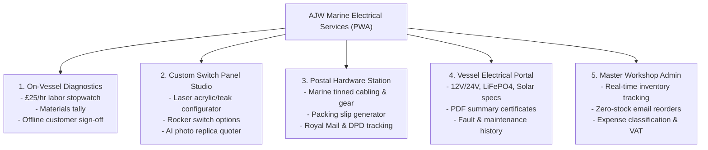
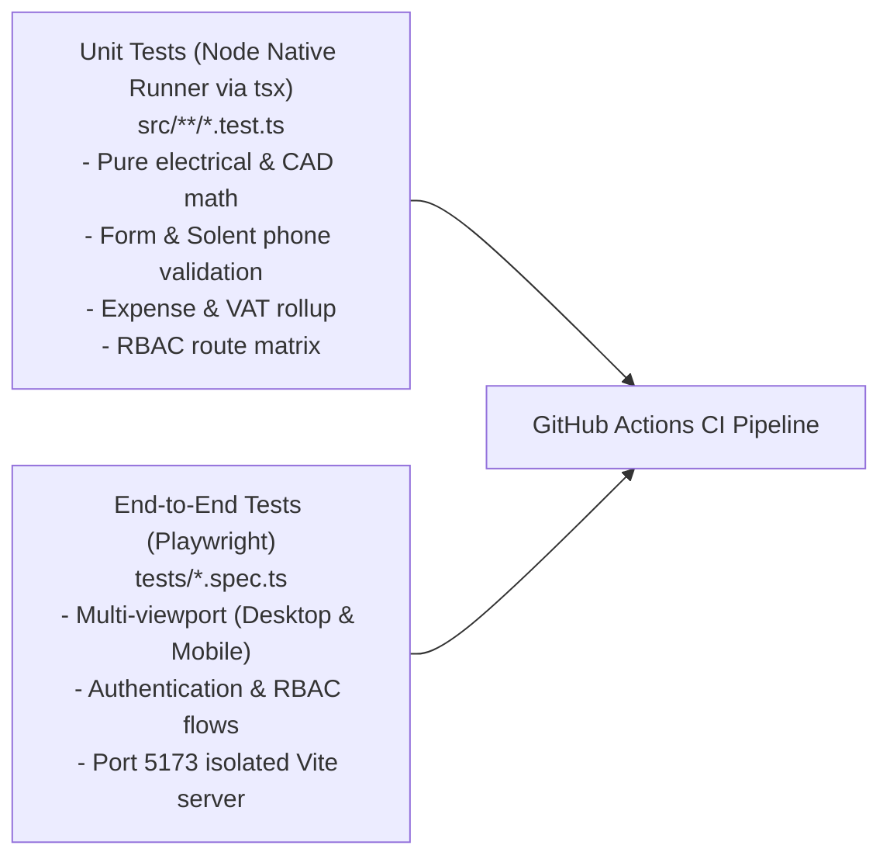

# AJW Marine Electrical Services (AJWMES)

[](https://nodejs.org/)
[](https://react.dev/)
[](https://www.typescriptlang.org/)
[](https://vitejs.dev/)
[](https://tailwindcss.com/)
[](https://playwright.dev/)
[](https://web.dev/progressive-web-apps/)

Specialized marine electrical diagnostics, lithium/solar power calculation, custom switch panel CAD design, and postal repair workshop management Progressive Web App (PWA).

Headquartered in Gosport, Hampshire, supporting marine vessels across the Solent marine basin (Portsmouth, Southampton, Hamble, Cowes, and Chichester).

- **Primary Domain**: [https://ajwmes.co.uk](https://ajwmes.co.uk)
- **Architecture Specification**: See [`DESIGN.md`](file:///Users/anthonywrather/Documents/Projects/ajwmes/ajwmes/DESIGN.md) for the 12-section technical architecture specification.
- **AI Agent Guidelines**: See [`AGENTS.md`](file:///Users/anthonywrather/Documents/Projects/ajwmes/ajwmes/AGENTS.md) and [`GEMINI.md`](file:///Users/anthonywrather/Documents/Projects/ajwmes/ajwmes/GEMINI.md) for automated agent pair-programming rules.

---

## Table of Contents
1. [Core Capabilities & Operational Pillars](#core-capabilities--operational-pillars)
2. [High-Level Architecture](#high-level-architecture)
3. [Quick Start (3-Minute Setup)](#quick-start-3-minute-setup)
4. [Quality Assurance & Testing Strategy](#quality-assurance--testing-strategy)
5. [Role-Based Access Control (RBAC)](#role-based-access-control-rbac)
6. [Master Configuration & Secrets Management](#master-configuration--secrets-management)
   - [Environment Variables Reference](#environment-variables-reference)
   - [Google AI Studio (Gemini AI Key)](#1-google-ai-studio-gemini-ai-key)
   - [Firebase Web App Configuration](#2-firebase-console-standard-web-app-config)
   - [Special Firebase & Google Cloud Keys](#3-special-firebase--google-cloud-keys)
   - [CI/CD Deployment Service Account](#4-cicd-deployment-service-account-github-actions)
   - [Production Hardening & Key Rotation](#5-production-hardening--key-rotation)
7. [In-App Diagnostics & Multi-Environment Isolation](#in-app-diagnostics--multi-environment-isolation)
8. [AI-Assisted Development & Control Files](#ai-assisted-development--control-files)
9. [Useful npm & Firebase Commands](#useful-npm--firebase-commands)

---

## Core Capabilities & Operational Pillars

The platform unifies five marine electrical operational workflows:



1. **On-Vessel Diagnostic Workstation**: Field technician portal for managing jobs, timing labor at a flat £25/hour rate, tracking marine materials used, logging vessel faults, and capturing pontoon digital customer signatures completely offline.
2. **Custom Switch Panel CAD Configurator & Replica Quoter**: Interactive design studio for custom switch panels (acrylic and teak), cut-out dimensioning, circuit rating assignment, and photographic replica extraction using Google Gemini AI for boat refits.
3. **Marine Hardware & Postal Fulfillment Station**: Storefront for marine-grade tinned copper conductors, Victron Energy equipment, Blue Sea Systems switchgear, and terminal consumables with an automated workshop packing queue, dispatch management, and Royal Mail / DPD tracking integration.
4. **Boat Owner Vessel Electrical Portal**: Digital vessel logbook storing 12V/24V electrical specifications, LiFePO4 lithium bank capacities, solar array outputs, wiring schematics, and client PDF summary certificate generation via `jspdf`.
5. **Master Workshop Management**: Administrative back-office for inventory control, automated zero-stock alert emails, supplier purchase order drafting (MakeFast, Solent Marine, Victron UK), expense classification, and laser cut file exports.

---

## High-Level Architecture

The system uses an **Offline-First Single-Page Application (SPA) / Progressive Web App (PWA)** architecture built on React 19 and Vite 8, backed by Google Firebase serverless cloud services and Google Gemini Generative AI.

- **Frontend & Build**: React 19, TypeScript (strict), Vite 8, Tailwind CSS v4 (`@tailwindcss/vite`), Motion, `vite-plugin-pwa`
- **Cloud & Backend**: Firebase v13 (Authentication & Cloud Firestore), `@google/genai`
- **Persistence**: Multi-tier storage with IndexedDB (`ajw_marine_field_db`), scoped LocalStorage (`ajwmes_<env>_*`), and Cloud Firestore realtime listeners.
- **Resilience**: Full offline degradation with automatic queuing of mutations when disconnected on the pontoon.

---

## Quick Start (3-Minute Setup)

### Prerequisites
- **Node.js**: `>=24.12.0` (Use `nvm use` or `fnm use` to adopt `.node-version`)
- **npm**: `>=10.x`

### 1. Clone & Install Dependencies
```bash
git clone https://github.com/anthonywrather/AJW-Marine-Electrical-Services.git ajwmes
cd ajwmes
npm install
```

### 2. Configure Environment Variables
Copy the template `.env.example` to `.env`:
```bash
cp .env.example .env
```
Populate your `VITE_FIREBASE_API_KEY` and project identifiers (see [Master Configuration](#master-configuration--secrets-management)).

### 3. Start the Development Server
```bash
npm run dev
```
Open [http://localhost:3000](http://localhost:3000) in your browser.

---

## Quality Assurance & Testing Strategy

This codebase enforces strict automated verification using a dual-tier testing pyramid:



### 1. Unit Testing Suite (`npm run test:unit`)
- Uses Node.js's built-in test runner (`node:test`, `node:assert/strict`) via `tsx --test "src/**/*.test.ts"`.
- Executes in under 2 seconds across all mathematical engines, validation schemas, and versioning tests.
- **Dynamic Test Discovery**: Any new test file matching `src/**/*.test.ts` is automatically picked up and run without modifying configuration files.

```bash
# Run unit test suite
npm run test:unit

# Or alias
npm test
```

### 2. End-to-End Browser Testing (`npm run test:e2e`)
- Built on **Playwright** (`@playwright/test`).
- Automatically launches an isolated Vite server on port `5173` before test execution to prevent port conflicts with active local development on port `3000`.
- Tests authenticate using deterministic `data-testid` selectors across Desktop Chrome and Mobile viewports (Pixel 5, iPhone 12).

```bash
# Run Playwright E2E suite headless
npm run test:e2e

# Run with interactive UI
npx playwright test --ui

# View HTML test report
npx playwright show-report
```

### 3. Full Pre-Flight Validation (`npm run validate`)
Runs the full battery of static type checks, unit tests, and production build verification:
```bash
npm run validate
```

---

## Role-Based Access Control (RBAC)

The system features 5 distinct user roles governed by [`src/lib/rbac.ts`](file:///Users/anthonywrather/Documents/Projects/ajwmes/ajwmes/src/lib/rbac.ts):

| Role | Access Scope | Accessible Application Routes |
| :--- | :--- | :--- |
| **`guest`** | Public visitors | Store, Switch Panel CAD Designer, Postal Order Tracking |
| **`client`** | Boat owners | Store, Switch Panel CAD, Postal Tracker, **Client Vessel Portal** |
| **`technician`** | Pontoon engineers | **Technician Field Workstation** (Stopwatch, Materials, Sign-Off), Store |
| **`postal`** | Workshop fulfillment | **Postal Dispatch Workstation** (Consignment Tracking, Packing), Store |
| **`admin`** | Master administrator | **Unrestricted Access** to all routes, Admin Operations Dashboard, Inventory, Expenses |

---

## Master Configuration & Secrets Management

### Environment Variables Reference

| Environment Variable | Required? | Exposure | Origin Platform | Purpose |
| :--- | :--- | :--- | :--- | :--- |
| `GEMINI_API_KEY` | Optional / Feature-dependent | **Private** (Server / AI Studio) | Google AI Studio | Authorizes Gemini generative AI queries for switch panel replica recognition. |
| `VITE_FIREBASE_API_KEY` | **Required** | **Public** (Client bundle) | Firebase Console / GCP | Authenticates client SDK requests with Firebase (Identity Toolkit & Firestore). |
| `VITE_FIREBASE_PROJECT_ID` | **Required** | **Public** (Client bundle) | Firebase Console | Uniquely identifies your Firebase / Google Cloud project. |
| `VITE_FIREBASE_APP_ID` | **Required** | **Public** (Client bundle) | Firebase Console | Identifies this specific registered web app instance in Firebase. |
| `VITE_FIREBASE_AUTH_DOMAIN` | **Required** | **Public** (Client bundle) | Firebase Console | Domain where Google OAuth redirects land. |
| `VITE_FIREBASE_STORAGE_BUCKET`| **Required** | **Public** (Client bundle) | Firebase Console | Cloud Storage bucket for panel photos and vessel schematics. |
| `VITE_FIREBASE_FIRESTORE_DATABASE_ID` | Optional | **Public** (Client bundle) | Firebase Console | Firestore database name. Default is `(default)`; set only if using a custom named database. |
| `VITE_FIREBASE_MESSAGING_SENDER_ID` | Optional | **Public** (Client bundle) | Firebase Console | Numeric Google Cloud project number used for Firebase Cloud Messaging. |
| `VITE_FIREBASE_MEASUREMENT_ID` | Optional | **Public** (Client bundle) | Firebase Console / GA4 | Google Analytics 4 stream measurement ID (`G-XXXXXXXXXX`). |
| `VITE_FIREBASE_OAUTH_CLIENT_ID` | Optional | **Public** (Client bundle) | Google Cloud Console | OAuth 2.0 Web Client ID for Google Identity sign-in popup flows. |
| `APP_URL` | Optional | Contextual | Hosting Provider | Base application URL (e.g. `http://localhost:3000` or `https://ajwmes.co.uk`). |
| `FIREBASE_SERVICE_ACCOUNT` | **CI/CD Only** | **Secret** (GitHub Secrets) | Firebase Console (GCP IAM) | Service account private key JSON string used by GitHub Actions to deploy to Firebase Hosting. |

---

### 1. Google AI Studio (Gemini AI Key)

Powers switch panel replica photo recognition and automated component extraction:
1. Navigate to [Google AI Studio](https://aistudio.google.com/).
2. Select your Google Cloud project and click **Get API key**.
3. Store this key in your local `.env` as `GEMINI_API_KEY` or in AI Studio's Secrets panel.

> [!WARNING]
> A Gemini API key created in Google AI Studio is **only** valid for Gemini Generative AI endpoints. It is **not** valid for Firebase Authentication. Never use your Gemini API key as `VITE_FIREBASE_API_KEY`.

---

### 2. Firebase Console (Standard Web App Config)

All client variables prefixed with `VITE_FIREBASE_*` come directly from your Firebase Web App configuration:
1. Open the [Firebase Console](https://console.firebase.google.com/) &rarr; **Project Settings (⚙️)**.
2. Under **Your apps**, select the **Web (`</>`)** app configuration snippet.
3. Map values to your `.env` file:
   - `apiKey` &rarr; `VITE_FIREBASE_API_KEY`
   - `projectId` &rarr; `VITE_FIREBASE_PROJECT_ID`
   - `appId` &rarr; `VITE_FIREBASE_APP_ID`
   - `authDomain` &rarr; `VITE_FIREBASE_AUTH_DOMAIN`
   - `storageBucket` &rarr; `VITE_FIREBASE_STORAGE_BUCKET`

---

### 3. Special Firebase & Google Cloud Keys

- **Named Database (`VITE_FIREBASE_FIRESTORE_DATABASE_ID`)**: Default is `(default)`. If using an AI Studio sandbox named database, paste the exact name string.
- **Authorized OAuth Origins**: Ensure `http://localhost:3000`, `http://localhost:5173`, and `https://ajwmes.co.uk` are listed in Google Cloud Console &rarr; Credentials &rarr; OAuth 2.0 Client IDs.
- **Enable Google Sign-In**: In Firebase Console &rarr; Build &rarr; Authentication &rarr; Sign-in method &rarr; Enable Google.

---

### 4. CI/CD Deployment Service Account (GitHub Actions)

Deployments are automated on push to `main` via [`.github/workflows/firebase-hosting-merge.yml`](file:///Users/anthonywrather/Documents/Projects/ajwmes/ajwmes/.github/workflows/firebase-hosting-merge.yml):
```bash
# Automated configuration via Firebase CLI
firebase init hosting:github
```
Or manually add `FIREBASE_SERVICE_ACCOUNT` (full JSON key) and `VITE_FIREBASE_API_KEY` to **GitHub Repository Settings &rarr; Secrets and variables &rarr; Actions**.

---

### 5. Production Hardening & Key Rotation

1. **Restrict Firebase API Key**: In Google Cloud Console &rarr; APIs & Services &rarr; Credentials &rarr; Web API Key, configure HTTP referrer restrictions for `ajwmes.co.uk/*` and restrict APIs to *Identity Toolkit*, *Token Service*, *Cloud Firestore*, and *Firebase Storage*.
2. **Server-Side Security Rules**: Client access control is enforced on the server by [`firestore.rules`](file:///Users/anthonywrather/Documents/Projects/ajwmes/ajwmes/firestore.rules).
3. **Emergency Key Rotation**: Invalidate compromised keys immediately in GCP IAM, generate new keys, update GitHub Secrets, and redeploy with `npm run build && firebase deploy --only hosting`.

---

## In-App Diagnostics & Multi-Environment Isolation

### 1. In-App "Fix Firebase API Key" Tool
If Google Sign-In displays an invalid API key warning on your live or staging deployment:
1. Open the **Sign In** modal in the top navigation.
2. Click **"Fix Firebase API Key"**.
3. Enter the verified key and click **Save Key**. It takes immediate effect in `localStorage` without requiring a redeployment!

### 2. 1-Click Developer Sign-In
Need to test administrative functions without completing OAuth?
- In the **Sign In** modal, click **"1-Click Sign In as Anthony Wrather (Admin)"**.
- Instantly grants administrative RBAC permissions to test quotes, panels, inventory, and diagnostics.

### 3. Multi-Environment Storage Scoping
The app automatically detects hosting domains and scopes LocalStorage keys so preview channels never pollute production data:
- `localhost`, `ais-dev-*.run.app` &rarr; `ajwmes_aistudio_dev_*`
- `ais-pre-*.run.app` &rarr; `ajwmes_aistudio_pre_*`
- `*--*.web.app` (PR previews) &rarr; `ajwmes_github_pre_*`
- `ajwmes.co.uk` &rarr; `ajwmes_github_live_*`

### 4. In-Browser Version Update Indicator & Single-Refresh Deployment
When a new release is deployed, `/version.json` and the Service Worker lifecycle controller ([`src/lib/appUpdater.ts`](file:///Users/anthonywrather/Documents/Projects/ajwmes/ajwmes/src/lib/appUpdater.ts)) automatically surface a top-level **New Version Available** indicator banner ([`src/components/common/AppUpdateBanner.tsx`](file:///Users/anthonywrather/Documents/Projects/ajwmes/ajwmes/src/components/common/AppUpdateBanner.tsx)) and a header **Update Ready** badge. Clicking **Update & Refresh Now** (or refreshing the browser once) flushes stale Workbox caches and deploys the new release on the **first refresh**.

---

## AI-Assisted Development & Control Files

This codebase is specifically optimized for pair programming with autonomous AI coding agents:

- [`AGENTS.md`](file:///Users/anthonywrather/Documents/Projects/ajwmes/ajwmes/AGENTS.md): Master pair-programming guide, directory map, and architectural constraints.
- [`GEMINI.md`](file:///Users/anthonywrather/Documents/Projects/ajwmes/ajwmes/GEMINI.md): Antigravity, Google AI Studio, and Gemini CLI prompt instructions.
- [`.cursorrules`](file:///Users/anthonywrather/Documents/Projects/ajwmes/ajwmes/.cursorrules): Cursor & Windsurf IDE coding rules and style constraints.
- [`.github/copilot-instructions.md`](file:///Users/anthonywrather/Documents/Projects/ajwmes/ajwmes/.github/copilot-instructions.md): GitHub Copilot rules for Pull Requests and inline suggestions.
- [`.agents/rules/`](file:///Users/anthonywrather/Documents/Projects/ajwmes/ajwmes/.agents/rules): Modular Antigravity rules for QA automation, marine electrical formulas, and offline resilience.

---

## Useful npm & Firebase Commands

```bash
# Start local dev server (port 3000)
npm run dev

# Run TypeScript type check
npm run lint

# Run all unit tests (Auth, Electrical, Expenses, Forms, Versioning)
npm run test:unit

# Run Playwright end-to-end browser tests
npm run test:e2e

# Run complete pre-flight check (lint + unit tests + build)
npm run validate

# Build production assets for deployment
npm run build

# Preview production build locally
npm run preview

# Deploy manually to Firebase Hosting
firebase deploy --only hosting

# Deploy to a temporary PR preview channel (valid for 7 days)
firebase hosting:channel:deploy preview-feature-name
```

---

## Support & Contributing

- **Author**: Anthony Wrather (AJW Marine Electrical Services)
- **Primary Domain**: [https://ajwmes.co.uk](https://ajwmes.co.uk)
- **Location**: Gosport, Hampshire, United Kingdom
- **Contributions**: Please verify that `npm run validate` passes with zero errors before submitting Pull Requests.
