# AJW Marine Electrical Services — E2E User Journeys & QA Roadmap Specification

> **Classification:** Engineering & QA Automation Architecture Document  
> **Author:** Principal Full Stack Engineer, Cloud Infrastructure Platform Engineer & QA Automation Specialist  
> **Application Version:** `v1.2.0` | **Target Runtime:** Node `>=24.12.0`  
> **Test Framework:** Playwright (`@playwright/test`) with 16 E2E Spec Suites, 11 Page Object Models (POM) & 291 Unit Tests  
> **Date:** October 2026  

---

## Executive Summary

AJW Marine Electrical Services (AJWMES) operates a mission-critical, offline-first Progressive Web App (PWA) servicing boat owners, pontoon field technicians, postal fulfillment staff, workshop administration, and platform infrastructure administrators across the Solent marine basin.

To guarantee zero regression in critical business paths, high-stakes electrical calculations, server-side Cloud Function gateways, and resilient offline operations, this document:
1. **Audits and details all 16 existing end-to-end (E2E) test suites** currently executed in `tests/` alongside the **11 Page Object Models** in `tests/pages/`.
2. **Maps the complete user journey coverage matrix** across all 6 RBAC personas (`guest`, `client`, `technician`, `postal`, `admin`, `site`).
3. **Presents a prioritized Phase 1–4 engineering and QA automation roadmap** with risk and complexity scoring.
4. **Specifies the next set of recommended user journeys (`UJ-12`, `UJ-17`, `UJ-18`, `UJ-19`)**, complete with component trees, state matrices, `data-testid` locator contracts, and Page Object Model (POM) blueprints.

---

## 1. Existing Covered User Journeys (16 Automated Spec Suites)

The Playwright E2E test suite covers **16 core operational and architectural journeys** utilizing **11 dedicated Page Object Models** (`tests/pages/`):

```mermaid
graph TD
    subgraph ExistingJourneys["Covered E2E Journeys (16 Spec Suites)"]
        J1["1. Authentication & RBAC Navigation (UJ-01)\n(tests/authentication.spec.ts)"]
        J2["2. Hardware Catalog & Stock Sync (UJ-02)\n(tests/inventory-stock-sync.spec.ts)"]
        J3["3. Cloud Function Resend Email Gateway (UJ-03)\n(tests/resend.spec.ts)"]
        J4["4. Field Technician Diagnostic & Sign-Off (UJ-04)\n(tests/technician-diagnostic-flow.spec.ts)"]
        J5["5. Postal Fulfillment & 4x6 Thermal Labels (UJ-05)\n(tests/postal-fulfillment-dispatch.spec.ts)"]
        J6["6. Consignment Timeline Tracker (UJ-06)\n(tests/consignment-tracker.spec.ts)"]
        J7["7. Master Workshop Admin & Expenses (UJ-10)\n(tests/admin-workshop-management.spec.ts)"]
        J8["8. Offline Pontoon Resilience (UJ-11)\n(tests/offline-pontoon-resilience.spec.ts)"]
        J9["9. Custom Switch Panel CAD Configurator (UJ-07)\n(tests/switch-panel-cad.spec.ts)"]
        J10["10. Weathered Switchboard Photo Replica Quoter (UJ-08)\n(tests/switchboard-photo-replica.spec.ts)"]
        J11["11. Boat Owner Vessel Portal & PDF Export (UJ-09)\n(tests/vessel-portal-pdf.spec.ts)"]
        J12["12. Store Checkout & Stripe Settlement (UJ-13)\n(tests/stripe.spec.ts)"]
        J13["13. In-Browser Version Rollout & 1st-Refresh Deploy (UJ-14)\n(tests/app-version-update.spec.ts)"]
        J14["14. Responsive Pill Menu & 2-Row Containment (UJ-15)\n(tests/navigation-responsive-menu.spec.ts)"]
        J15["15. Lazy Code-Splitting & PWA Asset Integrity (UJ-16)\n(tests/performance-architecture-optimization.spec.ts)"]
        J16["16. Site Admin Role & Config Decoupling (UJ-20)\n(tests/rbac-site-role.spec.ts)"]
    end

    J1 -->|"Session Rehydration & Profiles"| POM1["AuthModalPage\nNavigationPage\nVesselPortalPage"]
    J2 -->|"Stock Sync & Cart Interactions"| POM2["StorePage\nCartDrawerPage"]
    J3 -->|"Server-Side sendEmail Gateway"| POM3["EnvironmentSettingsModal\nAuthModalPage"]
    J4 -->|"Stopwatch, Materials & Canvas Signature"| POM4["TechnicianWorkspacePage"]
    J5 -->|"ShipStation Rates, 4x6 Label & Slip"| POM5["PostalWorkspacePage"]
    J6 -->|"Milestones, Checkpoints & Status Simulator"| POM6["ConsignmentTrackerPage"]
    J7 -->|"Expenses, POs, Rollups & Snapshots"| POM7["AdminDashboardPage"]
    J8 -->|"Faraday Blackout, Photo Queue & Auto-Replay"| POM8["TechnicianWorkspacePage"]
    J9 -->|"CAD Layout, SVG Export, Cart & Quote"| POM9["SwitchPanelCADPage\nCartDrawerPage"]
    J10 -->|"Presets, Live Surcharges & Lightbox"| POM10["ReplicaPanelUploaderPage\nAdminDashboardPage"]
    J11 -->|"Multi-Vessel Specs, History & jsPDF"| POM11["VesselPortalPage\nStorePage"]
    J12 -->|"pk_test Override, Card Checkout & Deposit"| POM12["StorePage\nCartDrawerPage\nVesselPortalPage"]
    J13 -->|"version.json Poll, Banner & 1-Click Reload"| POM13["NavigationPage\nAppUpdateBanner"]
    J14 -->|"2-Row Desktop Wrap & Compact Mobile Grid"| POM14["NavigationPage\nAuthModalPage"]
    J15 -->|"Dynamic Chunks & Raster/SVG Icons"| POM15["NavigationPage\nSwitchPanelCADPage\nReplicaPanelUploaderPage"]
    J16 -->|"Exclusive Platform Config & Role Isolation"| POM16["NavigationPage\nAdminDashboardPage\nAuthModalPage"]
```

---

### Journey 1: Authentication, Multi-Persona RBAC & Profile Management (UJ-01)
- **Test File:** [`tests/authentication.spec.ts`](file:///Users/anthonywrather/Documents/Projects/ajwmes/ajwmes/tests/authentication.spec.ts)
- **Page Objects Used:** `NavigationPage`, `AuthModalPage`, `StorePage`, `CartDrawerPage`, `VesselPortalPage`
- **Target Personas:** `guest`, `client`, `technician`, `postal`, `admin`

#### Scenarios Verified:
1. **Guest Browsing & Workshop Collection Order**:
   - Unauthenticated guest lands on the responsive landing page, navigates to Parts Store, adds tinned copper marine cable to cart, selects *Gosport Workshop Collection (FREE)*, enters Haslar Pontoon contact details, completes payment, and confirms order creation (`AJW-POST-*`).
2. **Administrator Authentication & Route Access**:
   - Sign in via modal using admin credentials (`anthonywrather@gmail.com`), asserting redirection to Anthony's Operations Dashboard and updating header navigation with the authenticated user profile.
3. **Profile Details & Custom Avatar Selection**:
   - Switching user avatars via system preset graphics (Helm Navigator, Cruiser Captain) and validating direct photo file upload (base64 data URL preview and storage).
4. **Vessel Specification Access Gating**:
   - Role-based visibility of the Vessel Specifications tab: strictly hidden for `technician` and `postal` personas, dynamically restored for `client` and `admin`.
   - Inspection of registered vessels list and transition to full Vessel Portal.
   - Live editing of vessel dimensions (LOA, LWL, Beam, Draft) and Hull Type selection (Monohull Fin Keel, Bilge Keel, Catamaran, RIB, Tender).
5. **Unregistered Boat Owner Onboarding & Checkout**:
   - New boat owner registration omitting vessel specs, landing on the Vessel Portal unregistered state, and flowing seamlessly into workshop parts ordering.
6. **Multi-Environment Configuration & Version Pinning**:
   - Header version badge display linking SemVer to GitHub commit SHA (`v1.2.0-[sha]`).
   - Production mode validation: disabling development-only 1-click test personas and testing hints when running in production live environments.

---

### Journey 2: Marine Hardware Store, Cart Drawer & Live Stock Synchronization (UJ-02)
- **Test File:** [`tests/inventory-stock-sync.spec.ts`](file:///Users/anthonywrather/Documents/Projects/ajwmes/ajwmes/tests/inventory-stock-sync.spec.ts)
- **Page Objects Used:** `StorePage`, `CartDrawerPage`
- **Target Personas:** `client`, `guest`, `admin`

#### Scenarios Verified:
1. **Catalog Browsing & Category Filtering**:
   - Loading marine cables, fuses, busbars, and Victron equipment with live price and stock counts.
   - Zero-stock warning badges and out-of-stock disabled state handling.
2. **Cart Drawer Interactions**:
   - Adding in-stock marine components, incrementing/decrementing quantities, and optimistic real-time price rollups.
   - Dynamic carrier calculation (Gosport Workshop Collection £0.00, Royal Mail Tracked 24/48 £4.50, DPD Next Day £8.50).
3. **Split Catalog Export/Import & Synchronization**:
   - Standalone Export Items and Export Categories to formatted JSON files.
   - Google Sheets/ERP synchronization simulation: importing updated Victron inventory items with merge mode validation.
   - Category management modal: adding new electrical propulsion classifications with JSON syntax validation.

---

### Journey 3: Server-Side Cloud Function Resend Email Gateway & Registration Dispatch (UJ-03)
- **Test File:** [`tests/resend.spec.ts`](file:///Users/anthonywrather/Documents/Projects/ajwmes/ajwmes/tests/resend.spec.ts)
- **Page Objects Used:** `NavigationPage`, `AuthModalPage`
- **Target Personas:** `client`, `guest`, `admin`

#### Scenarios Verified:
1. **Server-Side Cloud Function Email Gateway Card**:
   - Open Multi-Environment Manager modal via `header-version-badge` and inspect `resend-card`.
   - Verify `resend-mode-badge` confirms 2nd Gen Firebase Cloud Function (`europe-west2`) gateway architecture.
2. **Credential Isolation & Zero Client Secret Exposure**:
   - Verify client-side API key inputs (`resend-api-key-input`) are strictly not rendered in the DOM.
   - Audit browser `localStorage` to confirm zero Resend API key material is ever persisted on the client.
3. **Test Verification Dispatch via Cloud Function Gateway**:
   - Trigger `test-resend-email-button` and verify `resend-notice` confirms dispatch (with automatic simulated outbox fallback in local test environments).
4. **Non-Blocking Welcome Notification on Registration**:
   - Register a new boat owner account (`James Admiral`) and verify background welcome email dispatch completes without blocking navigation to the Boat Owner Vessel Portal.

---

### Journey 4: Solent Marine Field Technician Diagnostics & Digital Sign-Off (UJ-04)
- **Test File:** [`tests/technician-diagnostic-flow.spec.ts`](file:///Users/anthonywrather/Documents/Projects/ajwmes/ajwmes/tests/technician-diagnostic-flow.spec.ts)
- **Page Objects Used:** `NavigationPage`, `AuthModalPage`, `TechnicianWorkspacePage`
- **Target Personas:** `technician`, `admin`

#### Scenarios Verified:
1. **Technician Authentication & Workspace Gating**:
   - Sign in using Solent marine technician credentials (`jack.tech@ajwmes.co.uk`), verifying instant redirection to `/technician` with user profile name.
2. **Job Queue Inspection, Filtering & Vessel Selection**:
   - Filter jobs by active/scheduled status pills and select assigned vessel jobs.
   - Inspect vessel specifications, berth location, and preliminary fault notes.
3. **Diagnostic Stopwatch Timing & Labor Rate Rollup**:
   - Start and pause live diagnostic stopwatch, verifying £25.00/hour flat rate labor calculations.
4. **Hardware Materials & Consumables Logging**:
   - Add parts from the workshop catalog into the active job sheet, verifying real-time materials summation and total due updates.
5. **Customer Pontoon Sign-Off with HTML5 Canvas Signature**:
   - Review itemized work sheet summary and authority role.
   - Draw handwritten signature aboard vessel using pointer/touch simulation on HTML5 `<canvas>`.
   - Submit sign-off and verify the Pontoon Customer Sign-Off Receipt Card is rendered with customer name and signature image.
6. **Job Completion Progression**:
   - Advance job progress state to Completed (`bg-emerald-600`).

---

### Journey 5: Postal Workshop Order Fulfillment, ShipStation 4x6" Thermal Labels & Dispatch (UJ-05)
- **Test File:** [`tests/postal-fulfillment-dispatch.spec.ts`](file:///Users/anthonywrather/Documents/Projects/ajwmes/ajwmes/tests/postal-fulfillment-dispatch.spec.ts)
- **Page Objects Used:** `NavigationPage`, `AuthModalPage`, `PostalWorkspacePage`
- **Target Personas:** `postal` (`sarah.postal@ajwmes.co.uk`), `admin`

#### Scenarios Verified:
1. **Postal Workstation Authentication & RBAC Gating**:
   - Sign in using workshop postal credentials (`sarah.postal@ajwmes.co.uk`), verifying dedicated redirection to `/postal` (`Gosport Marine Postal Dispatch Station`) with `Postal Role Active` badge.
2. **Fulfillment KPI Metrics & Queue Filtering**:
   - Audit top-level KPI counters (`metricAwaitingPacking`, `metricPacked`, `metricDispatched`, `metricDelivered`) and filter queue by `Needs Packing` (`filterOrdersReceived`).
3. **Workshop Pick & Pack List Inspection**:
   - Select active consignment card and inspect itemized `Workshop Pick & Pack List` and order total.
4. **Waterproof A4 Packing Slip Modal & Price Toggle**:
   - Open printable A4 Packing Slip modal (`packingSlipSheet`), verify Haslar Marina Trade Yard letterhead, toggle `toggleShowPrices`, and dismiss.
5. **ShipStation Live Carrier Rates & 4x6" Thermal Label Generation**:
   - Verify live carrier rates panel (`ratesPanel`), connection status badge (`connectionBadge`), and carrier rate cards (`rateCardRoyalMail24`, `rateCardDpdNextDay`).
   - Mark order packed on bench (`markOrderPacked`), select Royal Mail Tracked 24, and generate a 1-click **4x6" Thermal Shipping Label** (`thermalLabelModal`).
   - Assert generated UK tracking barcode (`/^GB\d{9}RM$/`), trigger thermal print (`printThermalLabelButton`), and dispatch order (`dispatchWithTracking`).
6. **Pontoon Delivery Confirmation & Visual Progress Timelines View**:
   - Advance consignment to `Delivered to Vessel / Marina` (`FULFILLED`).
   - Switch to `Order Progress Timelines & Lifecycle History` view and verify all 4 visual stepper milestones (`timeline-step-received`, `timeline-step-packed`, `timeline-step-dispatched`, `timeline-step-delivered`).
7. **Parallel Multi-Browser Worker Isolation**:
   - Seeds dedicated per-worker test consignments (`ord-worker-${workerIndex}`) with scoped search filtering (`ordersSearchInput.fill(workerOrderNumber)`) to guarantee deterministic execution across Chromium, Firefox, WebKit, Mobile Chrome, and Mobile Safari without cross-worker mutation collisions on shared Firestore collections.

---

### Journey 6: Solent Marine Postal Consignment Timeline Tracker (UJ-06)
- **Test File:** [`tests/consignment-tracker.spec.ts`](file:///Users/anthonywrather/Documents/Projects/ajwmes/ajwmes/tests/consignment-tracker.spec.ts)
- **Page Objects Used:** `NavigationPage`, `AuthModalPage`, `ConsignmentTrackerPage`
- **Target Personas:** `guest`, `client`, `admin`

#### Scenarios Verified:
1. **Navigation & Tab Access**:
   - Navigate to landing page and access Postal Order Tracker tab from both desktop navigation header and mobile bottom drawer.
2. **Consignments Queue Inspection & Order Switching**:
   - Inspect active consignment tabs and switch smoothly between multiple seed and customer orders (`AJW-POST-2841`, `AJW-POST-2839`, `AJW-POST-2845`).
3. **Postcode & Order Number Filtering**:
   - Filter consignments using real-time search query by order identifier and UK delivery postcode (e.g. `PO12`, `PO31`), validating instant search clearing.
4. **4-Stage Visual Timeline Milestones**:
   - Audit interactive 4-stage visual progress bar (Order Received, Processing & Cut, Dispatched, Delivered) across desktop and mobile viewports with dynamic percentage completion badges.
5. **Carrier Logistics & Reference Clipboard Interaction**:
   - Inspect carrier details (Royal Mail / DPD), tracking references, and verify single-click clipboard copy action.
6. **Simulated Live Carrier Checkpoints Modal**:
   - Open chronological carrier checkpoints modal, audit milestone logs (Sorted at Hub, Out for Delivery, Signed on Pontoon), and dismiss via close controls.
7. **Destination Specifications (Marina vs Residential)**:
   - Compare delivery metadata between Solent marina berths (vessel name, pontoon berth, gate codes) and UK mainland residential addresses.
8. **Parcel Contents Accordion & BOM Billing Totals**:
   - Toggle expandable parcel contents drawer to audit itemized bill of materials, quantities, unit prices, delivery fee, and total paid.
9. **Admin Session Continuity**:
   - Authenticate as Workshop Admin (`anthonywrather@gmail.com`) and verify active tracker state and profile continuity are preserved.
10. **Dynamic Order Lifecycle Simulation**:
    - Trigger quick status transitions (`processing` -> `dispatched` -> `delivered` -> `pending`) and verify real-time timeline recalculation, stage node styling, and fulfillment percentages.

---

### Journey 7: Master Workshop Administration, Expenses & Restock (UJ-10)
- **Test File:** [`tests/admin-workshop-management.spec.ts`](file:///Users/anthonywrather/Documents/Projects/ajwmes/ajwmes/tests/admin-workshop-management.spec.ts)
- **Page Objects Used:** `NavigationPage`, `AuthModalPage`, `AdminDashboardPage`
- **Target Personas:** `admin` (`anthonywrather@gmail.com`)

#### Scenarios Verified:
1. **Workshop Admin Authentication & Dashboard Redirection**:
   - Authenticate with administrator credentials (`anthonywrather@gmail.com`), asserting redirection to Anthony's Operations Dashboard (`/admin`) and profile badge rehydration.
2. **Top-Level Operational KPI Metrics Audit**:
   - Verify primary metric cards: Total Workload, Hours Diagnostic Labor, Gross Recorded Revenue (£), Non-Catalog Field Expenses (£), and Pending Replica/Custom Panel Quotes.
3. **Critical Depletion Warning & Supplier Reorder PO Flow**:
   - Inspect zero-stock alert banner for depleted workshop components.
   - Trigger Supplier Purchase Order modal, configure restock quantity, set express Solent courier speed, copy generated PO email to clipboard, dispatch purchase order, and execute instant stock replenishment.
4. **Non-Catalog Job Expenses & Financial KPI Accounting Summary**:
   - Access Non-Catalog Job Expenses tab and verify financial rollup summary: Total Recorded Disbursements, Fuel & Solent Travel, External Sub-Contractor Fees, and Client Billable vs Overhead absorbed.
5. **Field Non-Catalog Expense Recording with Client Billable Classification**:
   - Record a new out-of-pocket field disbursement (e.g. water taxi mooring launch, harbor fees, specialist gear hire) linked to an active vessel job with payee, receipt reference, date, payment method, and billable recharge designation.
6. **Search Filtering, Job Focus & Job Financial Rollup Summary**:
   - Filter disbursements by receipt reference and keyword search query, verifying real-time table filtering and filter reset.
   - Focus on an individual vessel job to audit the comprehensive Job Financial Rollup card: Diagnostic Labor, Catalog Materials, Non-Catalog Expenses, Client Total Billable, and Gross Job Margin (£ and %).
7. **Inline Billable vs Workshop Overhead Dynamic Recalculation**:
   - Toggle expense reimbursement status inline (`Workshop Overhead` <-> `Billable to Client`), verifying instantaneous state toggling and badge restyling.
8. **Expense Editing & Safe Deletion Confirmation**:
   - Open edit modal to modify disbursement amounts, verify optimistic update, and trigger safe deletion confirmation modal to permanently purge test expenses.
9. **Stock & Catalog Point-in-Time Save Points (Snapshots)**:
   - Switch to Stock & Catalog tab, open Save Points drawer, and generate a point-in-time rollback snapshot verifying timestamped catalog preservation.
10. **Accounting CSV Export Trigger**:
    - Trigger CSV export download for workshop accounting and bookkeeping.

---

### Journey 8: Solent Marine Pontoon Field Resilience, Offline Photo Capture & Mutation Replay (UJ-11)
- **Test File:** [`tests/offline-pontoon-resilience.spec.ts`](file:///Users/anthonywrather/Documents/Projects/ajwmes/ajwmes/tests/offline-pontoon-resilience.spec.ts)
- **Page Objects Used:** `NavigationPage`, `AuthModalPage`, `TechnicianWorkspacePage`
- **Target Personas:** `technician` (`jack.tech@ajwmes.co.uk`), `admin`

#### Scenarios Verified:
1. **Technician Authentication & Pontoon Diagnostics Setup**:
   - Authenticate as marine technician (`jack.tech@ajwmes.co.uk`), verify automatic redirection to `/technician`, assert active vessel job selection and initial "All Synced" connection status.
2. **Offshore Connectivity Drop & Graceful Degradation**:
   - Simulate complete network severance (`context.setOffline(true)`) reflecting pontoon Faraday cage conditions / metal hull signal blackout.
   - Verify status bar transitions dynamically to amber/red offline badge ("Offline - Local Storage Active", `data-testid="sync-status-badge"`).
3. **High-Payload Marine Defect Photo Capture & IndexedDB Queue**:
   - Technician captures high-resolution marine electrical fault photos (bilge wiring corrosion, burnt busbar).
   - Verify client-side canvas compression, preview gallery rendering, and queuing into local storage (`ajw_marine_field_db`), asserting pending queued photos badge increments.
4. **Offline Customer Pontoon Sign-Off with HTML5 Canvas Signature**:
   - Boat owner inspects offline diagnostic sheet and provides handwritten digital consent on HTML5 `<canvas>`.
   - Verify submission succeeds with zero network connectivity; payload is stored safely into mutation queue (`ajwmes_aistudio_dev_signoffs`).
   - Assert Pontoon Customer Sign-Off Receipt Card is rendered with owner name, timestamp, and signature graphic.
5. **Pontoon Reconnection & Automatic Mutation Replay**:
   - Restore marina network connectivity (`context.setOffline(false)`).
   - Assert sync bar updates state to "Syncing Local Changes..." with live progress percentage indicators.
   - Verify transactional mutation queue drains in prioritized order (signatures and job consent before heavy binary work photos).
6. **Queue Draining & Synchronization Completion**:
   - Assert mutation queue drains completely to 0 pending mutations.
   - Verify sync bar returns to emerald green "All Synced" state (`data-testid="sync-status-badge"`).

---

### Journey 9: Custom Switch Panel CAD Configurator (UJ-07)
- **Test File:** [`tests/switch-panel-cad.spec.ts`](file:///Users/anthonywrather/Documents/Projects/ajwmes/ajwmes/tests/switch-panel-cad.spec.ts)
- **Page Objects Used:** `NavigationPage`, `SwitchPanelCADPage`, `CartDrawerPage`
- **Target Personas:** `guest`, `client`, `admin`

#### Scenarios Verified:
1. **CAD Layout Preview & Default Sizing**:
   - Navigate to `/designer` via desktop tab or mobile menu drawer.
   - Assert default 6-gang initial panel preview, standard dimensions (190mm × 130mm), and baseline price (£175.00) computed by pure sizing logic.
   - Verify default voltmeter aperture and dual USB charging cutout are rendered in the live SVG drawing.
2. **Panel Material Selection & Dynamic Surcharges**:
   - Select Teak Veneer (+£25 surcharge => £200.00), Birch Plywood (+£15 surcharge => £190.00), and Matte Black Acrylic (£175.00 baseline), validating real-time plate re-coloring and price recalculations.
3. **Gang Count Scaling & Minimum Width Clamping**:
   - Scale panel from 6-gang to 8-gang (+£16 => £191.00); verify SVG dynamically adds switch positions and circuit label rows.
   - Test minimum width safety clamping: attempting to reduce width below minimum (180mm) automatically enforces the boundary rule with warning notices.
4. **Circuit Label Laser Engraving & Breaker Ratings**:
   - Customize individual circuit switches (e.g. `RADAR SCANNER` at 15A, `AUTOHELM` at 20A).
   - Verify SVG laser-engraved circuit labels and amperage text elements reflect custom configurations instantly.
5. **Readiness Packaging Tiers & Cutout Toggles**:
   - Toggle auxiliary cutouts (Voltmeter -£8, 12V marine socket cutout +£6), validating SVG rendering updates.
   - Transition through readiness tiers: *Faceplate Only* (£79.00), *DIY Assembly Kit* (£155.00), and *Assembled & Bench-Tested* (£210.00).
6. **Cloud Save & SVG CAD Export Download**:
   - Trigger cloud CAD state save, asserting success feedback badge.
   - Trigger SVG download and verify generated file nomenclature (`ajw_marine_switch_panel_8gang_...svg`).
7. **Direct Workshop Cart Dispatch**:
   - Add custom configured switch panel directly into the workshop cart (`£210.00`).
   - Verify cart drawer opens with custom switch panel line item, specification dimensions, and correct pricing.
8. **Specification Review Modal & Quote Request Flow**:
   - Open technical specification review modal, validating gang count, circuit listings (`RADAR SCANNER (15A)`, `AUTOHELM (20A)`), and price summary.
   - Proceed into Diagnostic Booking & Quote modal with pre-attached CAD configuration banner and pre-selected `custom_panel` service type.
   - Submit quotation request with vessel contact details, verifying generated booking confirmation reference (`AJW-2026-*`).

---

### Journey 10: Weathered Switchboard Photo Replica Quoter (UJ-08)
- **Test File:** [`tests/switchboard-photo-replica.spec.ts`](file:///Users/anthonywrather/Documents/Projects/ajwmes/ajwmes/tests/switchboard-photo-replica.spec.ts)
- **Page Objects Used:** `NavigationPage`, `ReplicaPanelUploaderPage`, `AuthModalPage`, `AdminDashboardPage`
- **Target Personas:** `guest`, `client`, `admin`

#### Scenarios Verified:
1. **Route Navigation & Cloud Storage Presence**:
   - Access `/replica` via desktop navigation bar and mobile drawer.
   - Assert `ReplicaPanelUploader` layout, cloud storage enabled badge, and turnaround commitment (3–5 Days Turnaround).
2. **Solent Classic Yacht Presets Autocompletion**:
   - Apply Westerly Konsort 29 template: auto-populates make (`Westerly`), model (`Konsort 29`), dimensions (`195mm x 140mm`), 8 switches, and acrylic black.
   - Apply Sadler 32 template: updates to Sadler 32 (`220mm x 150mm`), 10 switches, and solid marine teak.
3. **Dynamic Real-Time Estimation & Material Surcharges**:
   - Verify pure calculation engine `calculateReplicaPanelQuote` evaluates live:
     - Sadler 32 with 10 switches & Teak: £25 digitizing labor + £35 laser cut base + £25 teak surcharge + £80 switches hardware = **£165.00** total.
     - Surcharge badge `+£25.00 Teak Surcharge` dynamically appears.
     - Switching to Matte Black Acrylic removes surcharge, scaling 10 switches to **£140.00**.
     - Scaling switch count (6 switches => **£108.00**, 8 switches => **£124.00**).
4. **Photo Management, Lightbox & Cloud Upload**:
   - Inspect existing reference sample photo in `ImageLightboxModal` (title, cloud asset metadata, zoom controls), then dismiss.
   - Delete reference sample photo and verify photo card removal.
   - Upload new weathered switchboard damage photo with simulated PNG file payload.
   - Assert progress indicator, local/cloud storage persistence, and new photo entry rendering in the grid.
5. **Inquiry Submission & Seamless Vessel Portal Transition**:
   - Input specific boat requirements and mounting hole constraints in notes.
   - Submit inquiry via `Send Replica Panel Inquiry`.
   - Verify seamless transition to Vessel Portal (`ClientVesselPortal`).
   - Verify the new quote is listed with service category `Replica Replacement Switchboard`, status `Quote Requested`, reference (`AJW-REP-*`), and attached switchboard photos.
6. **Master Workshop Admin Inspection**:
   - Authenticate as Anthony Wrather (Admin) via AuthModal.
   - Access Master Workshop Operations Dashboard (`/admin`).
   - Audit operational metrics and verify newly submitted Westerly Konsort replica job is present in the workshop queue.

---

### Journey 11: Boat Owner Vessel Portal & Certificate PDF Export (UJ-09)
- **Test File:** [`tests/vessel-portal-pdf.spec.ts`](file:///Users/anthonywrather/Documents/Projects/ajwmes/ajwmes/tests/vessel-portal-pdf.spec.ts)
- **Page Objects Used:** `NavigationPage`, `AuthModalPage`, `VesselPortalPage`, `StorePage`
- **Target Personas:** `client` (`d.mercer@solent-sail.co.uk`), `admin`

#### Scenarios Verified:
1. **Client Authentication & Vessel Portal Access**:
   - Authenticate as registered Boat Owner client (David Mercer) via AuthModal quick-persona chip.
   - Assert user badge reflects client identity and navigate directly to `/portal` via responsive navigation.
   - Verify active primary vessel (`Windbird III`, Moody 33) renders with technical specs and owner UUID.
2. **Multi-Vessel Switching & Spec Isolation**:
   - Switch between multiple owned vessels in dropdown (`Solent Skiff` catamaran tender vs `Windbird III` cruising yacht).
   - Assert specifications dynamically update and maintain isolation across vessels.
3. **Sub-Tab Navigation (Specs, Jobs & Activity, Postal Orders)**:
   - Navigate to Jobs & Activity sub-tab: verify past rewire jobs (`AJW-2026-088`), diagnostic hours, and total costs.
   - Navigate to Postal Orders sub-tab: verify workshop postal consignments (`AJW-POST-2845`) and real-time carrier status.
   - Return seamlessly to Technical Specs & PDF sub-tab.
4. **Live Specification Category Navigation & Optimistic Editing**:
   - Inspect DC Batteries & Charging category (200Ah LiFePO4, SmartSolar MPPT, Orion DC-DC).
   - Inspect 230V AC Shore Power & Cathodic Galvanic Isolation category.
   - Enter edit mode under Overview category: update beam (`3.55m`) and draft (`1.48m`), save specs, and verify persistence.
5. **Electrical History Audit Log Creation**:
   - Record a new chronological maintenance entry (Victron SmartSolar MPPT 100/30 replacement with 40A MIDI fuse).
   - Verify immediate rendering in timeline with itemized parts chips (`16mm² Oceanflex Cable`).
6. **Additional Boat Portfolio Registration**:
   - Register a third vessel (`Solent Osprey`, Sadler 34) with build year, battery chemistry, marina, and berth.
   - Verify instant activation in portal and switcher dropdown.
7. **On-Board Print Station (PDF) Configuration & Interactive Preview**:
   - Open On-Board Technical Print Station modal.
   - Toggle layout modes (*Single-Page Chart Table Summary* vs *Multi-Page Comprehensive Dossier*).
   - Toggle color themes (*Solent Admiralty Navy* vs *High-Contrast Monochrome Ink Saver*).
   - Set custom skipper note and verify real-time interactive preview canvas (`WINDBIRD III`, `12V DC SYSTEM`, emergency isolation notices).
8. **Client-Side jsPDF Generation & Direct Print Routines**:
   - Trigger client-side jsPDF download, verifying blob creation without server round-trips.
   - Trigger direct print routine and dismiss modal cleanly.
9. **Unregistered Boat Owner Onboarding State & Store Fallback**:
   - Sign off and register a brand new boat owner account without vessels.
   - Verify landing on Vessel Portal displaying empty state card ("No Vessel Registered Yet").
   - Click "Order Parts from Workshop" button and confirm seamless store redirection.

---

### Journey 12: Online Hardware Store Checkout & Stripe Payment Settlement (UJ-13)
- **Test File:** [`tests/stripe.spec.ts`](file:///Users/anthonywrather/Documents/Projects/ajwmes/ajwmes/tests/stripe.spec.ts)
- **Page Objects Used:** `NavigationPage`, `StorePage`, `CartDrawerPage`, `AuthModalPage`, `VesselPortalPage`
- **Target Personas:** `guest`, `client`, `admin`

#### Scenarios Verified:
1. **Multi-Environment Inspector Stripe Status & Card Management**:
   - Open Multi-Environment Settings Modal via the version badge in the application header.
   - Assert Stripe Payment Gateway card rendering and initial state (Safe Dev / Simulated Mode with fallback reference ID generation).
   - Assert key override inputs, mode badges, and UK interchange fee note (1.5% + 20p).
2. **Publishable Key Format Validation**:
   - Attempt to persist an invalid or malformed Stripe key.
   - Verify immediate validation error banner requiring a valid `pk_test_...` or `pk_live_...` prefix.
3. **Dynamic Test Mode Activation & Session Reset**:
   - Enter a valid Stripe test publishable key (`pk_test_...`).
   - Save the key and assert immediate dynamic mode badge transition to `🧪 Stripe Test Mode (pk_test)`.
   - Clear the custom key and confirm clean session reset to Simulated Dev Mode.
4. **End-to-End Marine Hardware Store Checkout with Stripe**:
   - Navigate to `/store` and add marine tinned cable to the postal basket.
   - Open Cart Drawer, select Royal Mail delivery, and input recipient shipping address.
   - Proceed to payment and select **Credit / Debit Card (Stripe Card Checkout)**.
   - Assert presence of 256-bit encryption badge and card detail fields.
   - Authorize order and assert `Order Confirmed!` heading with audited `AJW-POST-*` order number and `pi_sim_*` Stripe payment reference.
5. **Boat Owner Diagnostic Quote Deposit Settlement via Stripe**:
   - Authenticate as registered Boat Owner client (David Mercer).
   - Navigate to Vessel Portal (`/portal`) and select the Jobs & Activity sub-tab.
   - Locate pending diagnostic job quote and trigger `Pay Deposit via Stripe`.
   - Assert real-time transition to `Deposit Secured via Stripe` with audited deposit balance updated to `Paid (£50)`.

---

### Journey 13: In-Browser Version Rollout Indicator & First-Refresh Deployment (UJ-14)
- **Test File:** [`tests/app-version-update.spec.ts`](file:///Users/anthonywrather/Documents/Projects/ajwmes/ajwmes/tests/app-version-update.spec.ts)
- **Page Objects Used:** `NavigationPage`
- **Target Personas:** `guest`, `client`, `technician`, `postal`, `admin`

#### Scenarios Verified:
1. **Baseline Up-to-Date Verification**:
   - Load application when `/version.json` matches running build; verify `app-update-banner` and `header-update-available-badge` are absent.
2. **Zero-Cache `/version.json` Rollout Detection on Tab Focus**:
   - Simulate deployment of a new commit (`v1.2.0-9cf41a2`) on `/version.json` (`Cache-Control: no-cache, no-store, must-revalidate`) and trigger window `focus`.
   - Assert top-level `app-update-banner` and sticky `header-update-available-badge` appear immediately displaying target version `v1.2.0-9cf41a2`.
3. **Banner Minimize with Persistent Header Pill**:
   - Dismiss top banner via `app-update-dismiss-button` and verify `header-update-available-badge` remains visible in the navigation bar.
4. **Single-Refresh Deployment Guarantee**:
   - Reload browser once (`page.reload()`) or click `Update & Refresh Now` (`app-update-reload-button`) and verify the new release (`v1.2.0-9cf41a2`) activates on the **first refresh** without requiring multiple reloads.
5. **Environment Manager Simulated Rollout & Offline Resilience**:
   - Trigger `simulate-version-update-button` from `EnvironmentSettingsModal`; verify offline update checks (`navigator.onLine = false`) gracefully report `Offline — using cached release`.

---

### Journey 14: Responsive Pill Navigation Bar, 2-Row Wrapping & Viewport Containment (UJ-15)
- **Test File:** [`tests/navigation-responsive-menu.spec.ts`](file:///Users/anthonywrather/Documents/Projects/ajwmes/ajwmes/tests/navigation-responsive-menu.spec.ts)
- **Page Objects Used:** `NavigationPage`, `AuthModalPage`
- **Target Personas:** `guest`, `client`, `admin`

#### Scenarios Verified:
1. **Desktop Bordered Pill Consistency & Colored Icons (`1440×900`)**:
   - Verify all guest desktop navigation tabs (`Parts Store`, `Track Order`, `Switch Panels`, `Replica Panels`) render uniform bordered pill geometry (`border`, `rounded-lg`) with `w-3.5` SVG icons and active state highlighting (`bg-sky-950`, `border-sky-500`).
2. **2-Row Desktop Menu Wrapping Without Horizontal Overflow (`1280×800`)**:
   - Authenticate as Admin (`anthonywrather@gmail.com`) with all 8 workspace tabs and as Client (`d.mercer@solent-sail.co.uk`) with 5 tabs.
   - Verify `desktopNavMenu` wraps cleanly into 2 rows (`rowCount === 2`) with zero horizontal scrollbar (`scrollWidth <= clientWidth`) and zero viewport overflow (`document.documentElement.scrollWidth <= 1280`).
3. **Compact Tablet & Mobile Hamburger Drawer Grid (`768×900` & `375×667`)**:
   - Verify mobile drawer buttons match compact pill dimensions (`px-2.5`, `py-1`, `rounded-lg`) fitting `>= 4` items on the first row at `768px` width and staying strictly contained within narrow portrait viewports (`375×667`).
4. **PWA Install Button Conditional Visibility Contract (Issue #29)**:
   - Verify in-app PWA install button (`pwa-install-button`) is strictly hidden by default on desktop viewports when `beforeinstallprompt` has not fired.
   - Verify the button transitions cleanly to visible upon browser dispatch of `beforeinstallprompt`, triggers native installation when clicked, and disappears upon acceptance.
   - Verify install triggers remain strictly hidden when running in standalone PWA display mode (`display-mode: standalone`).

---

### Journey 15: Code-Splitting Architecture, Lazy Workspaces & PWA Asset Integrity (UJ-16)
- **Test File:** [`tests/performance-architecture-optimization.spec.ts`](file:///Users/anthonywrather/Documents/Projects/ajwmes/ajwmes/tests/performance-architecture-optimization.spec.ts)
- **Page Objects Used:** `NavigationPage`, `AuthModalPage`, `SwitchPanelCADPage`, `ReplicaPanelUploaderPage`
- **Target Personas:** `guest`, `admin`

#### Scenarios Verified:
1. **PWA Rasterized PNG & Vector SVG Asset Verification**:
   - Assert `/icon-192.png` (`> 1KB`), `/icon-512.png` (`> 10KB`), and `/icon.svg` (valid `<svg>` with marine anchor path) return `HTTP 200` for standalone iOS/Android installation.
2. **Lazy-Loaded Route Chunk Mounting**:
   - Sequentially mount all code-split feature workspaces (`SwitchPanelDesigner`, `ReplicaPanelUploader`, `AdminDashboard`, `TechnicianWorkspace`, `PostalWorkspace`, `ClientVesselPortal`) and verify each suspense boundary resolves cleanly without main-bundle blocking.
3. **RBAC Guest Route Masking**:
   - Verify unauthenticated guests never render restricted navigation tabs (`nav-tab-technician`, `nav-tab-postal`, `nav-tab-admin`).

---

### Journey 16: Website Administrator Role & Platform Configuration Decoupling (UJ-20)
- **Test File:** [`tests/rbac-site-role.spec.ts`](file:///Users/anthonywrather/Documents/Projects/ajwmes/ajwmes/tests/rbac-site-role.spec.ts)
- **Page Objects Used:** `NavigationPage`, `AdminDashboardPage`, `AuthModalPage`
- **Target Personas:** `guest`, `admin`, `site`

#### Scenarios Verified:
1. **Exclusive Site Admin Platform Configuration**:
   - Verify `site` user (`site@ajwmes.co.uk`) can open `EnvironmentSettingsModal` via header version badge, mobile version button, and user dropdown menu.
   - Verify `site` user can update Firebase, Resend, and ShipStation API keys and trigger test mailers.
2. **Operational Admin Environment Lockdown**:
   - Verify `admin` user is strictly locked out of `EnvironmentSettingsModal` across all environments.
   - Verify `admin` header version badge is disabled (`cursor-default`) and does not launch the modal.
   - Verify direct URL attempts or backdoor modal mounts render `env-settings-access-denied` fallback.
3. **Role Elevation & Deletion Guardrails**:
   - Verify `admin` viewing `/admin` (`accounts` tab) sees `locked-site-role-badge` for `site` accounts with disabled edit/delete actions.
   - Verify `site` cannot be selected when creating or editing accounts as `admin`.
4. **Site Admin Navigation Scope**:
   - Verify `site` user has clean access to public routes (`/home`, `/store`, `/designer`, `/replica`, `/tracker`) and is blocked from private vessel portal and workshop operational workstations (`/admin`, `/technician`, `/postal`).

---

## 2. Comprehensive User Journey Coverage Matrix

The following table tracks all 20 operational and architectural journeys across AJWMES:

| Journey ID | Journey Title | Target Route(s) | Primary Persona(s) | Business Impact | Test Spec File | Status |
| :--- | :--- | :--- | :--- | :--- | :--- | :--- |
| **UJ-01** | **Authentication, Multi-Persona RBAC & Profile Management** | `/`, `/store`, `/portal`, `/admin` | All 6 Roles | **Critical (P0)** | `tests/authentication.spec.ts` | **Done (Automated)** |
| **UJ-02** | **Marine Hardware Store, Cart Drawer & Stock Sync** | `/store`, `/admin` | `guest`, `client`, `admin` | **High (P0)** | `tests/inventory-stock-sync.spec.ts` | **Done (Automated)** |
| **UJ-03** | **Server-Side Cloud Function Resend Email Gateway** | `/`, Env Modal | `guest`, `client`, `site` | **High (P0)** | `tests/resend.spec.ts` | **Done (Automated)** |
| **UJ-04** | **Solent Field Technician Diagnostics & Digital Sign-Off** | `/technician` | `technician`, `admin` | **Critical (P0)** | `tests/technician-diagnostic-flow.spec.ts` | **Done (Automated)** |
| **UJ-05** | **Postal Fulfillment, ShipStation Rates & 4x6" Thermal Labels** | `/postal` | `postal`, `admin` | **High (P0)** | `tests/postal-fulfillment-dispatch.spec.ts` | **Done (Automated)** |
| **UJ-06** | **Postal Consignment Timeline Tracker** | `/tracker` | `guest`, `client`, `admin` | **Medium (P1)** | `tests/consignment-tracker.spec.ts` | **Done (Automated)** |
| **UJ-07** | **Custom Switch Panel CAD Configurator** | `/designer` | `guest`, `client`, `admin`, `site` | **High (P1)** | `tests/switch-panel-cad.spec.ts` | **Done (Automated)** |
| **UJ-08** | **Weathered Switchboard Photo Replica Quoter** | `/replica` | `guest`, `client`, `admin`, `site` | **Medium (P2)** | `tests/switchboard-photo-replica.spec.ts` | **Done (Automated)** |
| **UJ-09** | **Boat Owner Vessel Portal & Certificate PDF Export** | `/portal` | `client`, `admin` | **High (P1)** | `tests/vessel-portal-pdf.spec.ts` | **Done (Automated)** |
| **UJ-10** | **Master Workshop Administration, Expenses & Restock** | `/admin` | `admin` | **High (P1)** | `tests/admin-workshop-management.spec.ts` | **Done (Automated)** |
| **UJ-11** | **Offline Pontoon Resilience & Mutation Queue Replay** | `/technician` | `technician`, `admin` | **Critical (P0)** | `tests/offline-pontoon-resilience.spec.ts` | **Done (Automated)** |
| **UJ-13** | **Hardware Store Checkout & Stripe Payment Settlement** | `/store`, `/portal` | `guest`, `client`, `admin`, `site` | **High (P0)** | `tests/stripe.spec.ts` | **Done (Automated)** |
| **UJ-14** | **In-Browser Version Rollout & 1st-Refresh Deployment** | Global / Header | All 6 Roles | **High (P1)** | `tests/app-version-update.spec.ts` | **Done (Automated)** |
| **UJ-15** | **Responsive Pill Navigation & 2-Row Viewport Containment** | Global Header | `guest`, `client`, `admin`, `site` | **Medium (P1)** | `tests/navigation-responsive-menu.spec.ts` | **Done (Automated)** |
| **UJ-16** | **Lazy Code-Splitting Workspaces & PWA Asset Integrity** | All Routes | `guest`, `admin`, `site` | **Medium (P1)** | `tests/performance-architecture-optimization.spec.ts` | **Done (Automated)** |
| **UJ-20** | **Site Admin Role & Platform Configuration Decoupling** | Global / `/admin` | `admin`, `site` | **Critical (P0)** | `tests/rbac-site-role.spec.ts` | **Done (Automated)** |
| **UJ-12** | **Bi-Directional Job Discussion, Photo Proofs & Inbound Email** | `/portal` ↔ `/admin` | `client`, `admin`, `technician` | **High (P1)** | *Proposed:* `tests/job-discussion-thread.spec.ts` | **Recommended Next (Phase 4.1)** |
| **UJ-17** | **Admin User Accounts Directory, Role Elevation & Isolation** | `/admin` (`accounts`) | `admin` | **High (P1)** | *Proposed:* `tests/admin-user-accounts.spec.ts` | **Recommended Next (Phase 4.2)** |
| **UJ-18** | **Print & Laser Engraving Studio & Cloud Panel Archive** | `/admin` (`print`, `panels`) | `admin` | **Medium (P2)** | *Proposed:* `tests/print-laser-asset-studio.spec.ts` | **Recommended Next (Phase 4.3)** |
| **UJ-19** | **Multi-Environment Sandbox Manager & JSON Data Portability** | Global Env Modal | `site` | **Medium (P2)** | *Proposed:* `tests/multi-environment-sandbox.spec.ts` | **Recommended Next (Phase 4.4)** |

---

## 3. Prioritized QA Automation Roadmap

```mermaid
flowchart LR
    subgraph P1["Phase 1: Core Operations (Done)"]
        direction TB
        U1["UJ-01: Auth & RBAC"]
        U2["UJ-02: Catalog & Stock Sync"]
        U3["UJ-03: Resend Cloud Function"]
        U4["UJ-04: Technician Diagnostics"]
        U5["UJ-05: Postal & ShipStation"]
        U10["UJ-10: Admin & Expenses"]
    end

    subgraph P2["Phase 2: Customer Experience (Done)"]
        direction TB
        U6["UJ-06: Consignment Tracker"]
        U7["UJ-07: Switch Panel CAD"]
        U8["UJ-08: Photo Replica Quoter"]
        U9["UJ-09: Vessel Portal & PDF"]
        U13["UJ-13: Stripe Settlement"]
    end

    subgraph P3["Phase 3: Platform & Resilience (Done)"]
        direction TB
        U11["UJ-11: Offline Pontoon Sync"]
        U14["UJ-14: 1st-Refresh Version Update"]
        U15["UJ-15: Responsive 2-Row Nav"]
        U16["UJ-16: Lazy Chunks & PWA Icons"]
    end

    subgraph P4["Phase 4: Next Recommendations (Planned)"]
        direction TB
        U12["UJ-12: Job Discussion, Photo Proofs & Inbound Email (P1)"]
        U17["UJ-17: Admin User Accounts & Role Elevation (P1)"]
        U18["UJ-18: Print & Laser Studio + Cloud Archive (P2)"]
        U19["UJ-19: Multi-Env JSON Portability & Seed Reset (P2)"]
    end

    P1 --> P2 --> P3 --> P4
```

---

## 4. Next Set of Recommended User Journeys & Engineering Blueprints

With all 15 Phase 1–3 user journeys fully automated, the following **four high-value user journeys (`UJ-12`, `UJ-17`, `UJ-18`, `UJ-19`)** represent the next recommended engineering and QA automation wave. Each targets live application capabilities in `src/components/` and `src/lib/` that currently lack dedicated end-to-end browser coverage.

---

### Recommendation 1 (Priority P1 — Immediate Next Candidate):
### **UJ-12: Bi-Directional Pontoon Job Discussion, Cloud Photo Proofs & Inbound Email Webhook Simulation**

- **Proposed Spec File:** `tests/job-discussion-thread.spec.ts`
- **Proposed Page Object Model:** `tests/pages/JobDiscussionThreadPage.ts`
- **Target Components:**
  - [`src/components/chat/JobDiscussionThread.tsx`](file:///Users/anthonywrather/Documents/Projects/ajwmes/ajwmes/src/components/chat/JobDiscussionThread.tsx)
  - [`src/components/client/ClientVesselPortal.tsx`](file:///Users/anthonywrather/Documents/Projects/ajwmes/ajwmes/src/components/client/ClientVesselPortal.tsx) (`Jobs & Activity` sub-tab)
  - [`src/components/admin/AdminDashboard.tsx`](file:///Users/anthonywrather/Documents/Projects/ajwmes/ajwmes/src/components/admin/AdminDashboard.tsx) (`Jobs` tab & `handleUploadWorkshopProof`)
  - [`src/lib/incomingEmail.ts`](file:///Users/anthonywrather/Documents/Projects/ajwmes/ajwmes/src/lib/incomingEmail.ts) (`simulateIncomingEmail`, `parseResendInboundWebhook`)
- **Target Personas:** `client` (`d.mercer@solent-sail.co.uk`) $\leftrightarrow$ `admin` (`anthonywrather@gmail.com`)

#### Business Value & Risk Justification:
The `JobDiscussionThread` bridges boat owners on the water with Anthony in the Gosport workshop. It coordinates quote approvals, £50 diagnostic deposit collection, laser-cut test fitment photo proofs, live postal fulfillment notifications inside the job chat, and inbound customer email replies. Automating this bi-directional flow guarantees zero communication drop-offs between `/portal` and `/admin`.

#### State Matrix & E2E Scenarios to Verify:
1. **Client Job Thread Inspection & Message Dispatch (`/portal`)**:
   - Sign in as Boat Owner (`d.mercer@solent-sail.co.uk`), navigate to `/portal` $\rightarrow$ `Jobs & Activity`, and inspect the active job thread header (`job.reference`, vessel name, berth location, flat rate `£25/hr`) and `Job Billing Sheet` sidebar (`Labor Hours`, `Labor Subtotal`, `Materials Used`, `Total Amount`, `Deposit Status`).
   - Send a client question (`"Can we fit the Victron SmartShunt behind the chart table bulkhead?"`) and assert immediate right-aligned sky-blue message bubble rendering (`bg-sky-600`).
2. **Client Switch Panel Photo Attachment & Lightbox Zoom**:
   - Attach a simulated PNG photo via the paperclip uploader (`handleAttachPhoto`); verify upload progress bar, `📷 [Attached Switch Panel Image: ...]` message bubble, and click-to-zoom inspection in `ImageLightboxModal`.
3. **Quote Approval Action (`quote_sent` $\rightarrow$ `quote_accepted`)**:
   - For a job in `quote_sent` state, verify `data-testid="approve-quote-button"` is visible to `client`, click `Approve Quote`, and verify status badge updates cleanly.
4. **Admin Reply & Workshop Laser Proof Photo Upload (`/admin`)**:
   - Switch session to Admin (`anthonywrather@gmail.com`), select the vessel job in `/admin`, verify the client's message and photo appear in the feed, and upload a **Laser Cut Proof & Test Fitting Photo** (`handleUploadWorkshopProof`).
   - Verify `🔬 [Laser Cut Proof & Test Fitting Photo]` message is appended to the thread and toast confirmation appears.
5. **Live Postal Fulfillment Event Card & Deep-Link to Visual Tracker**:
   - Verify postal dispatch notification messages (`Live Postal Fulfillment Event` card with `AJW-POST-*` reference) render with truck badge and click `Open in Visual Order Tracker` to confirm navigation to `/tracker` focused on that consignment.
6. **Inbound Email Webhook Bridge Simulation**:
   - Trigger simulated inbound customer email (`simulateIncomingEmail` matching `jobReference`) and verify `📩 [Inbound Email: ...]` is automatically threaded into the vessel's job discussion.

#### Required `data-testid` Locator Contract:
| Element | `data-testid` Attribute | Component |
| :--- | :--- | :--- |
| Discussion Thread Container | `job-discussion-thread` | `JobDiscussionThread.tsx` |
| Thread Status Badge | `job-thread-status-badge` | `JobDiscussionThread.tsx` |
| Message Feed Scroll Container | `chat-messages-feed` | `JobDiscussionThread.tsx` |
| Individual Message Bubble | `chat-message-bubble` | `JobDiscussionThread.tsx` |
| Postal Fulfillment Event Card | `chat-postal-event-card` | `JobDiscussionThread.tsx` |
| Open in Visual Order Tracker CTA | `chat-open-tracker-button` | `JobDiscussionThread.tsx` |
| Photo Attachment File Input | `chat-attach-photo-input` | `JobDiscussionThread.tsx` |
| Message Text Input | `chat-message-input` | `JobDiscussionThread.tsx` |
| Send Message Submit Button | `chat-send-button` | `JobDiscussionThread.tsx` |
| Approve Quote Button | `approve-quote-button` *(existing)* | `JobDiscussionThread.tsx` |
| Pay Deposit via Stripe Button | `stripe-pay-deposit-button` *(existing)* | `JobDiscussionThread.tsx` |
| Deposit Secured Badge | `stripe-deposit-secured-badge` *(existing)* | `JobDiscussionThread.tsx` |
| Admin Upload Workshop Proof Input | `admin-upload-proof-input` | `AdminDashboard.tsx` |

---

### Recommendation 2 (Priority P1):
### **UJ-17: Admin User Accounts Directory, Role Elevation & Environment Isolation**

- **Proposed Spec File:** `tests/admin-user-accounts.spec.ts`
- **Proposed Page Object Model:** `tests/pages/UserAccountsManagerPage.ts`
- **Target Components:**
  - [`src/components/admin/UserAccountsManager.tsx`](file:///Users/anthonywrather/Documents/Projects/ajwmes/ajwmes/src/components/admin/UserAccountsManager.tsx)
  - [`src/components/admin/AdminDashboard.tsx`](file:///Users/anthonywrather/Documents/Projects/ajwmes/ajwmes/src/components/admin/AdminDashboard.tsx) (`data-testid="admin-tab-accounts"`)
- **Target Persona:** `admin` (`anthonywrather@gmail.com`)

#### Business Value & Risk Justification:
`UserAccountsManager.tsx` (701 lines) governs RBAC role assignment (`client`, `technician`, `postal`, `admin`), boat owner vessel metadata, and strict environment-scoped account partitioning (`u.environment === currentEnv.envCode`). An E2E suite ensures administrators can onboard customers/staff, elevate permissions safely, and never leak user records across environments.

#### State Matrix & E2E Scenarios to Verify:
1. **Accounts Tab Access & Environment Partition Audit**:
   - Authenticate as Admin (`anthonywrather@gmail.com`), click `data-testid="admin-tab-accounts"`, and verify environment-scoped user count and role summary KPIs.
2. **Real-Time Search & Role Pill Filtering**:
   - Filter directory by role pills (`All`, `Client`, `Technician`, `Postal`, `Admin`).
   - Search by vessel name (`Windbird III`), marina berth (`Haslar Marina`), and email (`jack.tech@ajwmes.co.uk`), plus empty-state handling for unmatched queries.
3. **New Boat Owner / Staff Account Provisioning Modal**:
   - Open `Add User Account` modal, input full name (`Captain Eleanor Vance`), email (`e.vance@hamble-yachts.co.uk`), UK Solent phone (`023 9258 4411`), role (`client`), vessel name (`Hamble Star`), vessel type (`Sailing Yacht`), marina berth (`Port Hamble Marina`), and DC voltage (`24V`).
   - Submit and verify the new account card renders immediately in the directory.
4. **Inline RBAC Role Elevation & Profile Editing**:
   - Elevate the newly created user's role from `client` to `technician` (or edit via the Edit User modal) and verify role badge and permissions update immediately.
5. **Safe Account Deletion**:
   - Trigger account deletion for the test user and verify removal from the directory list.

#### Required `data-testid` Locator Contract:
| Element | `data-testid` Attribute | Component |
| :--- | :--- | :--- |
| User Accounts Admin Tab | `admin-tab-accounts` *(existing)* | `AdminDashboard.tsx` |
| User Accounts Manager Root | `user-accounts-manager` | `UserAccountsManager.tsx` |
| Search Accounts Input | `user-accounts-search-input` | `UserAccountsManager.tsx` |
| Role Filter Pills | `user-role-filter-{all\|client\|technician\|postal\|admin}` | `UserAccountsManager.tsx` |
| Open Add User Modal Button | `open-add-user-modal-button` | `UserAccountsManager.tsx` |
| Add User Form Inputs | `new-user-{name\|email\|phone\|role\|vessel}-input` | `UserAccountsManager.tsx` |
| Submit New User Button | `create-user-submit-button` | `UserAccountsManager.tsx` |
| User Account Row / Card | `user-account-card` | `UserAccountsManager.tsx` |
| Inline Role Select / Edit / Delete | `user-role-select`, `edit-user-button`, `delete-user-button` | `UserAccountsManager.tsx` |

---

### Recommendation 3 (Priority P2):
### **UJ-18: Print & Laser Engraving Marketing Asset Studio & Cloud Panel Archive**

- **Proposed Spec File:** `tests/print-laser-asset-studio.spec.ts`
- **Proposed Page Object Model:** `tests/pages/PrintLaserStudioPage.ts`
- **Target Components:**
  - [`src/components/admin/PrintLaserAssetStudio.tsx`](file:///Users/anthonywrather/Documents/Projects/ajwmes/ajwmes/src/components/admin/PrintLaserAssetStudio.tsx)
  - [`src/components/admin/AdminDashboard.tsx`](file:///Users/anthonywrather/Documents/Projects/ajwmes/ajwmes/src/components/admin/AdminDashboard.tsx) (`data-testid="admin-tab-print"` and `data-testid="admin-tab-panels"`)
- **Target Persona:** `admin` (`anthonywrather@gmail.com`)

#### Business Value & Risk Justification:
The Gosport workshop uses `PrintLaserAssetStudio` to generate both 300DPI print-ready marina handouts and dual-layer LightBurn laser engraving SVG files (`#FF0000` vector cut line + `#000000` raster engrave) on acrylic and teak, while `Panel Cloud Images` aggregates customer switchboard photos across all jobs.

#### State Matrix & E2E Scenarios to Verify:
1. **Business Card (`85mm × 55mm`) & A5 Marina Flyer (`148mm × 210mm`) Switching**:
   - Navigate to `/admin` $\rightarrow$ `data-testid="admin-tab-print"`.
   - Switch between Business Card (Front/Back flip) and A5 Marina Flyer previews, asserting flat rate (`£25 / HOUR + MATERIALS`) and Solent marina coverage text.
2. **Material Substrate Simulation Modes**:
   - Toggle render modes across `Print on Paper (PDF)`, `Laser Matte Black Acrylic`, and `Laser Solid Teak / Birch`, verifying preview surface styling updates.
3. **LightBurn Dual-Layer SVG Vector Export Verification**:
   - Trigger SVG download for both Business Card (`ajwmes-card-laser-lightburn.svg`) and A5 Flyer (`ajwmes-flyer-laser-lightburn.svg`).
   - Parse downloaded SVG payload and assert presence of `#FF0000` hairline vector cut `<rect>` (`stroke="#FF0000"`) and `#000000` raster engrave `<g>` layers.
4. **Panel Cloud Images Archive Inspection (`admin-tab-panels`)**:
   - Switch to `data-testid="admin-tab-panels"`, inspect aggregated switch panel reference photos across vessel jobs, open an asset in `ImageLightboxModal`, and jump directly to its parent job sheet.

---

### Recommendation 4 (Priority P2):
### **UJ-19: Multi-Environment Sandbox Manager, JSON Dataset Portability & Clean Seed Reset**

- **Proposed Spec File:** `tests/multi-environment-sandbox.spec.ts`
- **Proposed Page Object Model:** `tests/pages/EnvironmentSettingsModalPage.ts`
- **Target Components:**
  - [`src/components/modals/EnvironmentSettingsModal.tsx`](file:///Users/anthonywrather/Documents/Projects/ajwmes/ajwmes/src/components/modals/EnvironmentSettingsModal.tsx)
  - [`src/components/modals/FreeHostingGuideModal.tsx`](file:///Users/anthonywrather/Documents/Projects/ajwmes/ajwmes/src/components/modals/FreeHostingGuideModal.tsx)
- **Target Personas:** `admin`, `guest` (in Dev/Preview environments)

#### Business Value & Risk Justification:
Developers and QA engineers rely on `EnvironmentSettingsModal` to inspect active storage namespaces (`ajwmes_aistudio_dev_*` vs `ajwmes_github_pre_*`), reset deterministic workshop seed data (`Seed Clean Test Data`), and export/import full JSON environment snapshots between AI Studio and GitHub PR previews.

#### State Matrix & E2E Scenarios to Verify:
1. **Environment Detection & Namespace Audit**:
   - Open `EnvironmentSettingsModal` via `header-version-badge`, assert environment badge (`Dev Sandbox`), LocalStorage prefix (`ajwmes_aistudio_dev_*`), and Firestore collection prefix (`ais_dev_*`).
2. **Clean Test Data Seeding & State Reset**:
   - Mutate local state (e.g., delete or alter a job/item), trigger **Seed Clean Test Data**, and verify all baseline Solent vessels, jobs, and catalog items are deterministically restored.
3. **Full Environment JSON Export & Import Portability**:
   - Trigger JSON dataset export download, verify valid JSON schema envelope, and test importing a modified dataset snapshot into the active environment partition.
4. **Firebase & GitHub Free Hosting Guide Modal**:
   - Open `FreeHostingGuideModal` and verify interactive deployment documentation tabs and copyable CLI snippets.
