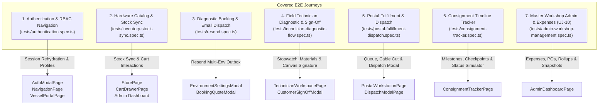
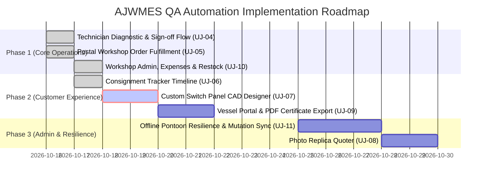

# AJW Marine Electrical Services — E2E User Journeys & QA Roadmap Specification

> **Classification:** Engineering & QA Automation Architecture Document  
> **Author:** Principal Full Stack Engineer, Cloud Infrastructure Platform Engineer & QA Automation Specialist  
> **Application Version:** `v1.2.0` | **Target Runtime:** Node `>=24.12.0`  
> **Test Framework:** Playwright (`@playwright/test`) with Page Object Models (POM)  
> **Date:** October 2026  

---

## Executive Summary

AJW Marine Electrical Services (AJWMES) operates a mission-critical, offline-first Progressive Web App (PWA) servicing boat owners, pontoon field technicians, postal fulfillment staff, and workshop administration across the Solent marine basin.

To guarantee zero regression in critical business paths, high-stakes electrical calculations, and resilient offline operations, this document:
1. **Audits and details existing end-to-end (E2E) test coverage** currently executed in `tests/`.
2. **Defines and maps all pending user journeys** across the application lifecycle.
3. **Presents a prioritized engineering and QA automation roadmap** with risk and complexity scoring.
4. **Recommends and specifies the next journey** to implement, complete with Page Object Model (POM) design and test assertions.

---

## 1. Existing Covered User Journeys

The Playwright E2E test suite covers four core operational journeys utilizing dedicated Page Object Models (`tests/pages/`):

---

### Journey 1: Authentication, Multi-Persona RBAC & Profile Management
- **Test File:** [`tests/authentication.spec.ts`](file:///Users/anthonywrather/Documents/Projects/ajwmes/ajwmes/tests/authentication.spec.ts)
- **Page Objects Used:** `NavigationPage`, `AuthModalPage`, `StorePage`, `CartDrawerPage`, `VesselPortalPage`
- **Target Personas:** `guest`, `client`, `technician`, `postal`, `admin`

#### Scenarios Verified:
1. **Guest Browsing & Workshop Collection Order**:
   - Unauthenticated guest lands on the responsive landing page, navigates to Parts Store, adds tinned copper marine cable to cart, selects *Gosport Workshop Collection (FREE)*, enters Haslar Pontoon contact details, completes payment, and confirms order creation (`AJW-POST-*`).
2. **Administrator Authentication & Route Access**:
   - Sign in via modal using admin credentials (`anthonywrather@gmail.com`), asserting redirection to Anthony's Operations Dashboard and updating header navigation with the authenticated user profile.
3. **Profile Details & Custom Avatar Selection**:
   - Switching user avatars via system preset graphics (Helm Navigator, Cruiser Captain) and validating direct photo file upload (base64 data URL preview and storage).
4. **Vessel Specification Access Gating**:
   - Role-based visibility of the Vessel Specifications tab: strictly hidden for `technician` and `postal` personas, dynamically restored for `client` and `admin`.
   - Inspection of registered vessels list and transition to full Vessel Portal.
   - Live editing of vessel dimensions (LOA, LWL, Beam, Draft) and Hull Type selection (Monohull Fin Keel, Bilge Keel, Catamaran, RIB, Tender).
5. **Unregistered Boat Owner Onboarding & Checkout**:
   - New boat owner registration omitting vessel specs, landing on the Vessel Portal unregistered state, and flowing seamlessly into workshop parts ordering.
6. **Multi-Environment Configuration & Version Pinning**:
   - Header version badge display linking SemVer to GitHub commit SHA (`v1.2.0-[sha]`).
   - Production mode validation: disabling development-only 1-click test personas and testing hints when running in production live environments.

---

### Journey 2: Marine Hardware Store, Cart Drawer & Live Stock Synchronization
- **Test File:** [`tests/inventory-stock-sync.spec.ts`](file:///Users/anthonywrather/Documents/Projects/ajwmes/ajwmes/tests/inventory-stock-sync.spec.ts)
- **Page Objects Used:** `StorePage`, `CartDrawerPage`
- **Target Personas:** `client`, `guest`, `admin`

#### Scenarios Verified:
1. **Catalog Browsing & Category Filtering**:
   - Loading marine cables, fuses, busbars, and Victron equipment with live price and stock counts.
   - Zero-stock warning badges and out-of-stock disabled state handling.
2. **Cart Drawer Interactions**:
   - Adding in-stock marine components, incrementing/decrementing quantities, and optimistic real-time price rollups.
   - Dynamic carrier calculation (Gosport Workshop Collection £0.00, Royal Mail Tracked 24/48 £4.50, DPD Next Day £8.50).
3. **Split Catalog Export/Import & Synchronization**:
   - Standalone Export Items and Export Categories to formatted JSON files.
   - Google Sheets/ERP synchronization simulation: importing updated Victron inventory items with merge mode validation.
   - Category management modal: adding new electrical propulsion classifications with JSON syntax validation.

---

### Journey 3: Diagnostic Booking & Email Dispatch Integration
- **Test File:** [`tests/resend.spec.ts`](file:///Users/anthonywrather/Documents/Projects/ajwmes/ajwmes/tests/resend.spec.ts)
- **Page Objects Used:** `NavigationPage`, `AuthModalPage`
- **Target Personas:** `client`, `guest`, `admin`

#### Scenarios Verified:
1. **Multi-Environment Resend Email Settings**:
   - Verifying Resend Email Integration card in the Environment Manager.
   - Distinguishing between Simulated Outbox mode (safe dev/staging) and Live API mode.
2. **API Key Validation & Security**:
   - Strict format validation of Resend API keys (`re_*` prefix with minimum 24 characters).
   - Key storage, simulated test email dispatch, and key reset fallbacks.
3. **Non-Blocking Welcome & Confirmation Notifications**:
   - Triggering background confirmation notifications during boat owner registration without blocking navigation or UI responsiveness.

---

### Journey 4: Solent Marine Field Technician Diagnostics & Digital Sign-Off
- **Test File:** [`tests/technician-diagnostic-flow.spec.ts`](file:///Users/anthonywrather/Documents/Projects/ajwmes/ajwmes/tests/technician-diagnostic-flow.spec.ts)
- **Page Objects Used:** `NavigationPage`, `AuthModalPage`, `TechnicianWorkspacePage`
- **Target Personas:** `technician`, `admin`

#### Scenarios Verified:
1. **Technician Authentication & Workspace Gating**:
   - Sign in using Solent marine technician credentials (`jack.tech@ajwmes.co.uk`), verifying instant redirection to `/technician` with user profile name.
2. **Job Queue Inspection, Filtering & Vessel Selection**:
   - Filter jobs by active/scheduled status pills and select assigned vessel jobs.
   - Inspect vessel specifications, berth location, and preliminary fault notes.
3. **Diagnostic Stopwatch Timing & Labor Rate Rollup**:
   - Start and pause live diagnostic stopwatch, verifying £25.00/hour flat rate labor calculations.
4. **Hardware Materials & Consumables Logging**:
   - Add parts from the workshop catalog into the active job sheet, verifying real-time materials summation and total due updates.
5. **Customer Pontoon Sign-Off with HTML5 Canvas Signature**:
   - Review itemized work sheet summary and authority role.
   - Draw handwritten signature aboard vessel using pointer/touch simulation on HTML5 `<canvas>`.
   - Submit sign-off and verify the Pontoon Customer Sign-Off Receipt Card is rendered with customer name and signature image.
6. **Job Completion Progression**:
   - Advance job progress state to Completed (`bg-emerald-600`).

---

### Journey 5: Postal Workshop Order Fulfillment, Cable Cutting & Dispatch
- **Test File:** [`tests/postal-fulfillment-dispatch.spec.ts`](file:///Users/anthonywrather/Documents/Projects/ajwmes/ajwmes/tests/postal-fulfillment-dispatch.spec.ts)
- **Page Objects Used:** `NavigationPage`, `AuthModalPage`, `PostalWorkstationPage`, `DispatchModalPage`
- **Target Personas:** `postal`, `admin`

#### Scenarios Verified:
1. **Postal Workstation Authentication & RBAC Gating**:
   - Sign in using workshop postal credentials (`sarah.postal@ajwmes.co.uk`), verifying dedicated access to `/postal` with operator identity.
2. **Pending Consignments Queue & Selection**:
   - Filter orders by pending/processing status and inspect customer delivery requirements (marina pontoon berth vs UK residential address).
3. **Custom Marine Cable Cutting & Bench Verification**:
   - Interactive cable cutting workstation: verify spool measurements, mark cut lengths, and confirm custom preparation.
4. **Hardware Picking Checklist & Verification**:
   - Audit individual line items, check off picked hardware components, and track order fulfillment readiness.
5. **Carrier Consignment Code Generation & Dispatch**:
   - Open dispatch modal, select carrier service (Royal Mail Tracked 24/48 or DPD Next Day), generate valid carrier consignment reference, and complete dispatch transition.
6. **Printable Packing Slip & Barcode Generation**:
   - Render printable HTML5 packing slip with order summary, recipient details, item breakdown, and verified dispatch metadata.

---

### Journey 6: Solent Marine Postal Consignment Timeline Tracker
- **Test File:** [`tests/consignment-tracker.spec.ts`](file:///Users/anthonywrather/Documents/Projects/ajwmes/ajwmes/tests/consignment-tracker.spec.ts)
- **Page Objects Used:** `NavigationPage`, `AuthModalPage`, `ConsignmentTrackerPage`
- **Target Personas:** `guest`, `client`, `admin`

#### Scenarios Verified:
1. **Navigation & Tab Access**:
   - Navigate to landing page and access Postal Order Tracker tab from both desktop navigation header and mobile bottom drawer.
2. **Consignments Queue Inspection & Order Switching**:
   - Inspect active consignment tabs and switch smoothly between multiple seed and customer orders (`AJW-POST-2841`, `AJW-POST-2839`, `AJW-POST-2845`).
3. **Postcode & Order Number Filtering**:
   - Filter consignments using real-time search query by order identifier and UK delivery postcode (e.g. `PO12`, `PO31`), validating instant search clearing.
4. **4-Stage Visual Timeline Milestones**:
   - Audit interactive 4-stage visual progress bar (Order Received, Processing & Cut, Dispatched, Delivered) across desktop and mobile viewports with dynamic percentage completion badges.
5. **Carrier Logistics & Reference Clipboard Interaction**:
   - Inspect carrier details (Royal Mail / DPD), tracking references, and verify single-click clipboard copy action.
6. **Simulated Live Carrier Checkpoints Modal**:
   - Open chronological carrier checkpoints modal, audit milestone logs (Sorted at Hub, Out for Delivery, Signed on Pontoon), and dismiss via close controls.
7. **Destination Specifications (Marina vs Residential)**:
   - Compare delivery metadata between Solent marina berths (vessel name, pontoon berth, gate codes) and UK mainland residential addresses.
8. **Parcel Contents Accordion & BOM Billing Totals**:
   - Toggle expandable parcel contents drawer to audit itemized bill of materials, quantities, unit prices, delivery fee, and total paid.
9. **Admin Session Continuity**:
   - Authenticate as Workshop Admin (`anthonywrather@gmail.com`) and verify active tracker state and profile continuity are preserved.
10. **Dynamic Order Lifecycle Simulation**:
    - Trigger quick status transitions (`processing` -> `dispatched` -> `delivered` -> `pending`) and verify real-time timeline recalculation, stage node styling, and fulfillment percentages.

---

### Journey 7: Master Workshop Administration, Expenses & Restock (UJ-10)
- **Test File:** [`tests/admin-workshop-management.spec.ts`](file:///Users/anthonywrather/Documents/Projects/ajwmes/ajwmes/tests/admin-workshop-management.spec.ts)
- **Page Objects Used:** `NavigationPage`, `AuthModalPage`, `AdminDashboardPage`
- **Target Personas:** `admin` (`anthonywrather@gmail.com`)

#### Scenarios Verified:
1. **Workshop Admin Authentication & Dashboard Redirection**:
   - Authenticate with administrator credentials (`anthonywrather@gmail.com`), asserting redirection to Anthony's Operations Dashboard (`/admin`) and profile badge rehydration.
2. **Top-Level Operational KPI Metrics Audit**:
   - Verify primary metric cards: Total Workload, Hours Diagnostic Labor, Gross Recorded Revenue (£), Non-Catalog Field Expenses (£), and Pending Replica/Custom Panel Quotes.
3. **Critical Depletion Warning & Supplier Reorder PO Flow**:
   - Inspect zero-stock alert banner for depleted workshop components.
   - Trigger Supplier Purchase Order modal, configure restock quantity, set express Solent courier speed, copy generated PO email to clipboard, dispatch purchase order, and execute instant stock replenishment.
4. **Non-Catalog Job Expenses & Financial KPI Accounting Summary**:
   - Access Non-Catalog Job Expenses tab and verify financial rollup summary: Total Recorded Disbursements, Fuel & Solent Travel, External Sub-Contractor Fees, and Client Billable vs Overhead absorbed.
5. **Field Non-Catalog Expense Recording with Client Billable Classification**:
   - Record a new out-of-pocket field disbursement (e.g. water taxi mooring launch, harbor fees, specialist gear hire) linked to an active vessel job with payee, receipt reference, date, payment method, and billable recharge designation.
6. **Search Filtering, Job Focus & Job Financial Rollup Summary**:
   - Filter disbursements by receipt reference and keyword search query, verifying real-time table filtering and filter reset.
   - Focus on an individual vessel job to audit the comprehensive Job Financial Rollup card: Diagnostic Labor, Catalog Materials, Non-Catalog Expenses, Client Total Billable, and Gross Job Margin (£ and %).
7. **Inline Billable vs Workshop Overhead Dynamic Recalculation**:
   - Toggle expense reimbursement status inline (`Workshop Overhead` <-> `Billable to Client`), verifying instantaneous state toggling and badge restyling.
8. **Expense Editing & Safe Deletion Confirmation**:
   - Open edit modal to modify disbursement amounts, verify optimistic update, and trigger safe deletion confirmation modal to permanently purge test expenses.
9. **Stock & Catalog Point-in-Time Save Points (Snapshots)**:
   - Switch to Stock & Catalog tab, open Save Points drawer, and generate a point-in-time rollback snapshot verifying timestamped catalog preservation.
10. **Accounting CSV Export Trigger**:
    - Trigger CSV export download for workshop accounting and bookkeeping.

---

## 2. Future User Journeys Requiring Test Coverage

The following table identifies the remaining operational workflows across AJWMES to be automated:

| Journey ID | Journey Title | Target Route | Primary Persona | Business Impact | Test Complexity | Status |
| :--- | :--- | :--- | :--- | :--- | :--- | :--- |
| **UJ-04** | **Solent Field Technician Diagnostics & Sign-off** | `/technician` | `technician`, `admin` | **Critical (P0)** | High (Canvas, Timer, Offline) | **Done (Automated)** |
| **UJ-05** | **Postal Workshop Order Fulfillment & Dispatch** | `/postal` | `postal`, `admin` | **High (P0)** | Medium (Queue, Cable cutting, Packing slip) | **Done (Automated)** |
| **UJ-06** | **Postal Consignment Timeline Tracker** | `/tracker` | `guest`, `client` | **Medium (P1)** | Low-Medium (Carrier links, Search) | **Done (Automated)** |
| **UJ-10** | **Master Workshop Administration, Expenses & Restock** | `/admin` | `admin` | **High (P1)** | Medium-High (Financial rollups, POs) | **Done (Automated)** |
| **UJ-07** | **Custom Carling Switch Panel CAD Configurator** | `/designer` | `guest`, `client`, `admin` | **High (P1)** | High (Grid CAD, BOM pricing, Surcharges) | **Next Recommended** |
| **UJ-08** | **Weathered Switchboard Photo Replica Quoter** | `/replica` | `guest`, `client`, `admin` | **Medium (P2)** | Medium (Image upload, Dimensions) | Pending |
| **UJ-09** | **Boat Owner Vessel Portal & Certificate PDF Export** | `/portal` | `client`, `admin` | **High (P1)** | Medium (jsPDF verification, Specs) | Pending |
| **UJ-11** | **Offline Pontoon Resilience & Mutation Queue Replay** | Any / `/technician` | `technician` | **Critical (P0)** | High (IndexedDB, Service Worker) | Pending |

---

## 3. Prioritized QA Automation Roadmap

---

## 4. Recommended Next Journey to Implement

### Recommendation: **Journey 7 — Custom Carling Switch Panel CAD Configurator**
**File Target:** `tests/switch-panel-cad.spec.ts`  
**Page Object Model:** `tests/pages/SwitchPanelCADPage.ts`

### Architectural & Business Rationale:
1. **Interactive Marine CAD Configuration**:
   - The Carling switch panel configurator (`/designer`) is one of AJWMES's core commercial revenue streams.
   - Customers design custom CNC-cut acrylic/aluminum switchboards with customizable rows, columns, rocker switches, circuit breakers, voltmeter apertures, and USB charging sockets.
2. **Real-Time BOM & Electrical Pricing Rollups**:
   - Every CAD component addition dynamically impacts labor, raw material cutting surcharges, component costs, and laser engraving fees computed via `src/utils/electricalCalculations.ts`.
3. **Cart Integration & Quote Submission**:
   - Tests verify that configured panel layouts generate accurate bills of materials, correctly transition into the cart drawer or custom quotation pipeline, and export visual CAD specifications.
