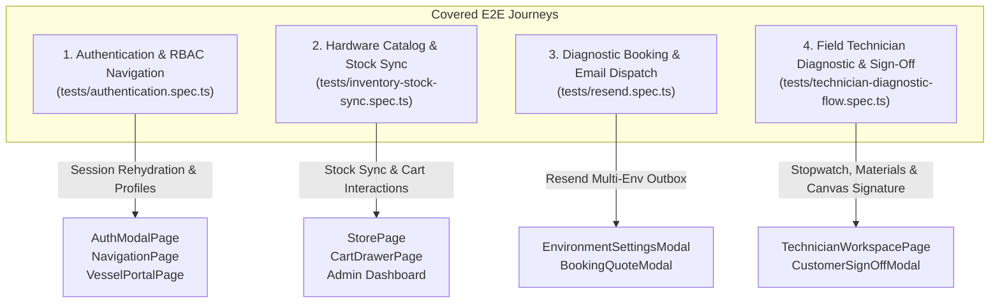
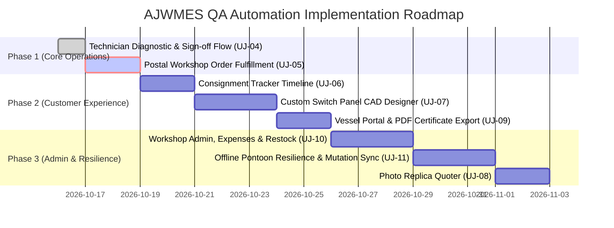

# AJW Marine Electrical Services — E2E User Journeys & QA Roadmap Specification

> **Classification:** Engineering & QA Automation Architecture Document  
> **Author:** Principal Full Stack Engineer, Cloud Infrastructure Platform Engineer & QA Automation Specialist  
> **Application Version:** `v1.2.0` | **Target Runtime:** Node `>=24.12.0`  
> **Test Framework:** Playwright (`@playwright/test`) with Page Object Models (POM)  
> **Date:** October 2026  

---

## Executive Summary

AJW Marine Electrical Services (AJWMES) operates a mission-critical, offline-first Progressive Web App (PWA) servicing boat owners, pontoon field technicians, postal fulfillment staff, and workshop administration across the Solent marine basin.

To guarantee zero regression in critical business paths, high-stakes electrical calculations, and resilient offline operations, this document:
1. **Audits and details existing end-to-end (E2E) test coverage** currently executed in `tests/`.
2. **Defines and maps all pending user journeys** across the application lifecycle.
3. **Presents a prioritized engineering and QA automation roadmap** with risk and complexity scoring.
4. **Recommends and specifies the next journey** to implement, complete with Page Object Model (POM) design and test assertions.

---

## 1. Existing Covered User Journeys

The Playwright E2E test suite covers four core operational journeys utilizing dedicated Page Object Models (`tests/pages/`):

---

### Journey 1: Authentication, Multi-Persona RBAC & Profile Management
- **Test File:** [`tests/authentication.spec.ts`](file:///Users/anthonywrather/Documents/Projects/ajwmes/ajwmes/tests/authentication.spec.ts)
- **Page Objects Used:** `NavigationPage`, `AuthModalPage`, `StorePage`, `CartDrawerPage`, `VesselPortalPage`
- **Target Personas:** `guest`, `client`, `technician`, `postal`, `admin`

#### Scenarios Verified:
1. **Guest Browsing & Workshop Collection Order**:
   - Unauthenticated guest lands on the responsive landing page, navigates to Parts Store, adds tinned copper marine cable to cart, selects *Gosport Workshop Collection (FREE)*, enters Haslar Pontoon contact details, completes payment, and confirms order creation (`AJW-POST-*`).
2. **Administrator Authentication & Route Access**:
   - Sign in via modal using admin credentials (`anthonywrather@gmail.com`), asserting redirection to Anthony's Operations Dashboard and updating header navigation with the authenticated user profile.
3. **Profile Details & Custom Avatar Selection**:
   - Switching user avatars via system preset graphics (Helm Navigator, Cruiser Captain) and validating direct photo file upload (base64 data URL preview and storage).
4. **Vessel Specification Access Gating**:
   - Role-based visibility of the Vessel Specifications tab: strictly hidden for `technician` and `postal` personas, dynamically restored for `client` and `admin`.
   - Inspection of registered vessels list and transition to full Vessel Portal.
   - Live editing of vessel dimensions (LOA, LWL, Beam, Draft) and Hull Type selection (Monohull Fin Keel, Bilge Keel, Catamaran, RIB, Tender).
5. **Unregistered Boat Owner Onboarding & Checkout**:
   - New boat owner registration omitting vessel specs, landing on the Vessel Portal unregistered state, and flowing seamlessly into workshop parts ordering.
6. **Multi-Environment Configuration & Version Pinning**:
   - Header version badge display linking SemVer to GitHub commit SHA (`v1.2.0-[sha]`).
   - Production mode validation: disabling development-only 1-click test personas and testing hints when running in production live environments.

---

### Journey 2: Marine Hardware Store, Cart Drawer & Live Stock Synchronization
- **Test File:** [`tests/inventory-stock-sync.spec.ts`](file:///Users/anthonywrather/Documents/Projects/ajwmes/ajwmes/tests/inventory-stock-sync.spec.ts)
- **Page Objects Used:** `StorePage`, `CartDrawerPage`
- **Target Personas:** `client`, `guest`, `admin`

#### Scenarios Verified:
1. **Catalog Browsing & Category Filtering**:
   - Loading marine cables, fuses, busbars, and Victron equipment with live price and stock counts.
   - Zero-stock warning badges and out-of-stock disabled state handling.
2. **Cart Drawer Interactions**:
   - Adding in-stock marine components, incrementing/decrementing quantities, and optimistic real-time price rollups.
   - Dynamic carrier calculation (Gosport Workshop Collection £0.00, Royal Mail Tracked 24/48 £4.50, DPD Next Day £8.50).
3. **Split Catalog Export/Import & Synchronization**:
   - Standalone Export Items and Export Categories to formatted JSON files.
   - Google Sheets/ERP synchronization simulation: importing updated Victron inventory items with merge mode validation.
   - Category management modal: adding new electrical propulsion classifications with JSON syntax validation.

---

### Journey 3: Diagnostic Booking & Email Dispatch Integration
- **Test File:** [`tests/resend.spec.ts`](file:///Users/anthonywrather/Documents/Projects/ajwmes/ajwmes/tests/resend.spec.ts)
- **Page Objects Used:** `NavigationPage`, `AuthModalPage`
- **Target Personas:** `client`, `guest`, `admin`

#### Scenarios Verified:
1. **Multi-Environment Resend Email Settings**:
   - Verifying Resend Email Integration card in the Environment Manager.
   - Distinguishing between Simulated Outbox mode (safe dev/staging) and Live API mode.
2. **API Key Validation & Security**:
   - Strict format validation of Resend API keys (`re_*` prefix with minimum 24 characters).
   - Key storage, simulated test email dispatch, and key reset fallbacks.
3. **Non-Blocking Welcome & Confirmation Notifications**:
   - Triggering background confirmation notifications during boat owner registration without blocking navigation or UI responsiveness.

---

### Journey 4: Solent Marine Field Technician Diagnostics & Digital Sign-Off
- **Test File:** [`tests/technician-diagnostic-flow.spec.ts`](file:///Users/anthonywrather/Documents/Projects/ajwmes/ajwmes/tests/technician-diagnostic-flow.spec.ts)
- **Page Objects Used:** `NavigationPage`, `AuthModalPage`, `TechnicianWorkspacePage`
- **Target Personas:** `technician`, `admin`

#### Scenarios Verified:
1. **Technician Authentication & Workspace Gating**:
   - Sign in using Solent marine technician credentials (`jack.tech@ajwmes.co.uk`), verifying instant redirection to `/technician` with user profile name.
2. **Job Queue Inspection, Filtering & Vessel Selection**:
   - Filter jobs by active/scheduled status pills and select assigned vessel jobs.
   - Inspect vessel specifications, berth location, and preliminary fault notes.
3. **Diagnostic Stopwatch Timing & Labor Rate Rollup**:
   - Start and pause live diagnostic stopwatch, verifying £25.00/hour flat rate labor calculations.
4. **Hardware Materials & Consumables Logging**:
   - Add parts from the workshop catalog into the active job sheet, verifying real-time materials summation and total due updates.
5. **Customer Pontoon Sign-Off with HTML5 Canvas Signature**:
   - Review itemized work sheet summary and authority role.
   - Draw handwritten signature aboard vessel using pointer/touch simulation on HTML5 `<canvas>`.
   - Submit sign-off and verify the Pontoon Customer Sign-Off Receipt Card is rendered with customer name and signature image.
6. **Job Completion Progression**:
   - Advance job progress state to Completed (`bg-emerald-600`).

---

## 2. Future User Journeys Requiring Test Coverage

The following table identifies the remaining operational workflows across AJWMES to be automated:

| Journey ID | Journey Title | Target Route | Primary Persona | Business Impact | Test Complexity | Status |
| :--- | :--- | :--- | :--- | :--- | :--- | :--- |
| **UJ-04** | **Solent Field Technician Diagnostics & Sign-off** | `/technician` | `technician`, `admin` | **Critical (P0)** | High (Canvas, Timer, Offline) | **Done (Automated)** |
| **UJ-05** | **Postal Workshop Order Fulfillment & Dispatch** | `/postal` | `postal`, `admin` | **High (P0)** | Medium (Queue, Cable cutting, Packing slip) | **Next Recommended** |
| **UJ-06** | **Postal Consignment Timeline Tracker** | `/tracker` | `guest`, `client` | **Medium (P1)** | Low-Medium (Carrier links, Search) | Pending |
| **UJ-07** | **Custom Carling Switch Panel CAD Configurator** | `/designer` | `guest`, `client`, `admin` | **High (P1)** | High (Grid CAD, BOM pricing, Surcharges) | Pending |
| **UJ-08** | **Weathered Switchboard Photo Replica Quoter** | `/replica` | `guest`, `client`, `admin` | **Medium (P2)** | Medium (Image upload, Dimensions) | Pending |
| **UJ-09** | **Boat Owner Vessel Portal & Certificate PDF Export** | `/portal` | `client`, `admin` | **High (P1)** | Medium (jsPDF verification, Specs) | Pending |
| **UJ-10** | **Master Workshop Administration, Expenses & Restock** | `/admin` | `admin` | **High (P1)** | Medium-High (Financial rollups, POs) | Pending |
| **UJ-11** | **Offline Pontoon Resilience & Mutation Queue Replay** | Any / `/technician` | `technician` | **Critical (P0)** | High (IndexedDB, Service Worker) | Pending |

---

## 3. Prioritized QA Automation Roadmap

---

## 4. Recommended Next Journey to Implement

### Recommendation: **Journey 5 — Postal Workshop Order Fulfillment & Dispatch Flow**
**File Target:** `tests/postal-fulfillment-dispatch.spec.ts`  
**Page Object Model:** `tests/pages/PostalWorkspacePage.ts`

### Architectural & Business Rationale:
1. **Closing the Physical E-Commerce Fulfillment Loop**:
   - We already have the store and cart ordering journey (`tests/inventory-stock-sync.spec.ts` and `tests/authentication.spec.ts`).
   - When orders are placed, workshop dispatchers must cut tinned marine cable, package orders, generate waterproof A4 packing slips (`PackingSlipModal.tsx`), and assign Royal Mail / DPD tracking numbers.
2. **High Interaction Surface with State Machine Transitions**:
   - Exercises the 6-stage order fulfillment pipeline: `received` $\to$ `processing` $\to$ `packed` $\to$ `ready_for_pickup` $\to$ `dispatched` $\to$ `delivered`.
   - Tests carrier selection and consignment number validation.
3. **Precursor to Journey 6 (Consignment Tracker)**:
   - Fulfilling orders and assigning tracking numbers generates the data consumed by the customer tracking portal (`tests/pages/OrderTrackingPage.ts`).
