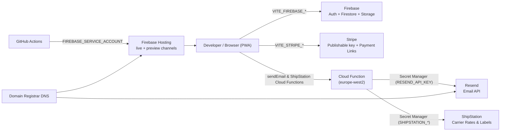

# Supporting Services Setup Guide

> **Audience:** A new maintainer who has cloned this repository and needs to create every account, key, and endpoint required to run **development**, deploy **preview** builds, and operate **production** (`https://ajwmes.co.uk`).
>
> **Related docs:** [`README.md`](../README.md) · [`DESIGN.md`](../DESIGN.md) · [`FIREBASE_GITHUB_DEPLOYMENT_GUIDE.md`](../FIREBASE_GITHUB_DEPLOYMENT_GUIDE.md) · [`.env.example`](../.env.example)

---

## Table of Contents

1. [Service Overview](#1-service-overview)
2. [Environment Matrix (Dev / Preview / Prod)](#2-environment-matrix-dev--preview--prod)
3. [Prerequisites & Accounts](#3-prerequisites--accounts)
4. [Firebase (Auth, Firestore, Storage, Hosting, Analytics)](#4-firebase-auth-firestore-storage-hosting-analytics)
5. [Stripe (Payments)](#5-stripe-payments)
6. [Resend (Transactional Email)](#6-resend-transactional-email)
7. [Google Gemini (Optional AI Features)](#7-google-gemini-optional-ai-features)
7b. [ShipStation (Postal Dispatch & Carrier Labels)](#7b-shipstation-carrier-api--cloud-functions-gateway-postal-dispatch)
8. [GitHub Repository, Actions & Secrets](#8-github-repository-actions--secrets)
9. [Custom Domain & DNS](#9-custom-domain--dns)
10. [Per-Environment Setup Checklists](#10-per-environment-setup-checklists)
11. [Verifying a Deployment](#11-verifying-a-deployment)
12. [Key Rotation & Troubleshooting](#12-key-rotation--troubleshooting)
13. [Known Limitations & Roadmap](#13-known-limitations--roadmap)

---

## 1. Service Overview

| Service | Used For | Required? | Code Entry Point | Fallback When Not Configured |
| :--- | :--- | :--- | :--- | :--- |
| **Firebase Authentication** | Google sign-in, user profiles, RBAC roles | **Required** for real sign-in | [`src/lib/auth.ts`](../src/lib/auth.ts) | 1-click developer profiles |
| **Cloud Firestore** | Jobs, catalog, postal orders, vessel specs, expenses | **Required** for cloud sync | [`src/lib/firebase.ts`](../src/lib/firebase.ts), [`firestore.rules`](../firestore.rules) | Offline cache ([`src/lib/offlineSync.ts`](../src/lib/offlineSync.ts)) |
| **Cloud Storage for Firebase** | Panel photos, catalog images, schematics | Recommended | [`src/lib/storage.ts`](../src/lib/storage.ts) | Inline / IndexedDB images |
| **Firebase Hosting** | Serving the PWA (live + preview channels) | **Required** to deploy | [`firebase.json`](../firebase.json), [`.firebaserc`](../.firebaserc) | — |
| **Google Analytics 4** | Operational event tracking | Optional | [`src/lib/analytics.ts`](../src/lib/analytics.ts) | Events are no-ops |
| **Stripe** | Diagnostic deposits & storefront payments | Optional | [`src/lib/stripeConfig.ts`](../src/lib/stripeConfig.ts), [`src/lib/stripeService.ts`](../src/lib/stripeService.ts) | **Simulated** payments |
| **Resend** | Quote, dispatch & zero-stock alert emails | Optional | [`src/lib/resendConfig.ts`](../src/lib/resendConfig.ts), [`src/lib/emailService.ts`](../src/lib/emailService.ts) | **Simulated** outbox (console log) |
| **ShipStation** | Postal carrier rates (Royal Mail, DPD) & 4x6" thermal labels | Optional | [`src/lib/shipstationConfig.ts`](../src/lib/shipstationConfig.ts), [`src/lib/shipstationService.ts`](../src/lib/shipstationService.ts) | **Simulated** rates & deterministic 4x6" SVG thermal label fallback |
| **Google Gemini** | AI features (switch-panel photo replica) | Optional | `@google/genai` | Feature disabled |
| **GitHub Actions** | CI tests + automated deploys | **Required** for CD | [`.github/workflows/`](../.github/workflows) | Manual `firebase deploy` |



> [!NOTE]
> Every `VITE_*` variable is inlined into the public JavaScript bundle at build time. Treat them as **public**. Genuine secrets (service accounts, Stripe secret keys `sk_...`) must only ever live in GitHub Secrets or Google Secret Manager.

---

## 2. Environment Matrix (Dev / Preview / Prod)

The app detects its environment from the hostname ([`src/lib/environment.ts`](../src/lib/environment.ts)) and scopes both browser storage and Firestore collections so non-production data never touches production records.

| | **Development** | **Preview** | **Production** |
| :--- | :--- | :--- | :--- |
| **Hostnames** | `localhost`, `127.0.0.1`, `ais-dev-*.run.app` | `*--*.web.app` (Firebase preview channels), `ais-pre-*.run.app` | `ajwmes.co.uk`, `<project>.web.app` |
| **LocalStorage prefix** | `ajwmes_aistudio_dev_*` | `ajwmes_github_pre_*` / `ajwmes_aistudio_pre_*` | `ajwmes_github_live_*` |
| **Firestore collections** | `ais_dev_*` | `gh_pre_*` / `ais_pre_*` | Root (`jobs`, `catalog`, `users`, …) |
| **Firebase project** | Shared project (see note) | Shared project | Shared project |
| **Where config lives** | Local `.env` | GitHub Secrets → CI build | GitHub Secrets → CI build |
| **Stripe mode** | Test (`pk_test_…`) or simulated | Test (`pk_test_…`) | Live (`pk_live_…`) |
| **Resend** | Simulated (no key) or `onboarding@resend.dev` | Simulated or test key | Verified `ajwmes.co.uk` domain |
| **Deployed by** | `npm run dev` | `firebase hosting:channel:deploy <name>` (manual) | Push / merge to `main` → [`firebase-hosting-merge.yml`](../.github/workflows/firebase-hosting-merge.yml) |

> [!IMPORTANT]
> Today **all environments share one Firebase project** and isolation relies on collection prefixes. Moving to one Firebase project per environment is tracked in [Issue #21](https://github.com/AnthonyWrather/ajwmes/issues/21). If you are setting up from scratch you may create separate projects now — just point each environment's `VITE_FIREBASE_*` values (and `.firebaserc` aliases) at the matching project.

### Configuration precedence

For Firebase, Stripe and Resend the app resolves configuration in this order (highest first):

1. **In-app override** saved from the *Environment Settings* modal / *Fix Firebase API Key* tool (scoped `localStorage`).
2. **Build-time `VITE_*` variable** from `.env` (local) or GitHub Secrets (CI).
3. **Committed fallback** — for Firebase only, [`firebase-applet-config.json`](../firebase-applet-config.json).
4. **Simulated mode** — for Stripe and Resend when no valid key is found.

> [!WARNING]
> `messagingSenderId`, `measurementId` and `oAuthClientId` are currently read **only** from [`firebase-applet-config.json`](../firebase-applet-config.json) (not from `.env`). If you create a new Firebase project, update that file as well as your `VITE_FIREBASE_*` variables.

---

## 3. Prerequisites & Accounts

### Local tooling

```bash
# Node 24 (matches .node-version / .nvmrc)
nvm use            # or: fnm use

# Firebase CLI
npm install -g firebase-tools
firebase login

# GitHub CLI (for secrets & PRs)
brew install gh    # macOS
gh auth login

# Project dependencies + Playwright browsers
npm install
npx playwright install
```

### Accounts to create

| Account | Sign-up URL | Notes |
| :--- | :--- | :--- |
| Google account | <https://accounts.google.com> | Owns Firebase / Google Cloud. Use a business account, not a personal one, for production. |
| Firebase / Google Cloud | <https://console.firebase.google.com> | Blaze (pay-as-you-go) plan is needed for Cloud Functions and some Storage regions; Spark (free) is enough to start. |
| Stripe | <https://dashboard.stripe.com/register> | Business verification is required before **live** mode is enabled. |
| Resend | <https://resend.com/signup> | Free tier covers low volume transactional email. |
| Google AI Studio | <https://aistudio.google.com> | Optional — only for Gemini features. |
| GitHub | <https://github.com> | Admin access to `AnthonyWrather/ajwmes` (or your fork). |
| Domain registrar | e.g. Cloudflare, Namecheap, 123-reg | You need DNS access for `ajwmes.co.uk` (Hosting + Resend records). |

---

## 4. Firebase (Auth, Firestore, Storage, Hosting, Analytics)

### 4.1 Create the project

1. Open the [Firebase Console](https://console.firebase.google.com/) → **Add project**.
2. Name it (e.g. `ajwmes-prod`; add `ajwmes-dev` / `ajwmes-staging` if you are separating environments).
3. Enable **Google Analytics** if you want GA4 (creates a `G-XXXXXXXXXX` measurement ID).
4. Link the folder to the project:

   ```bash
   firebase use --add          # pick the project, give it an alias (e.g. "default" or "prod")
   ```

   This updates [`.firebaserc`](../.firebaserc).

### 4.2 Register the web app & map config

1. **Project settings (⚙️) → General → Your apps → Add app → Web (`</>`)**.
2. Tick **Also set up Firebase Hosting**.
3. Copy the generated `firebaseConfig` values into `.env`:

| `firebaseConfig` field | `.env` variable | Also update `firebase-applet-config.json`? |
| :--- | :--- | :--- |
| `apiKey` | `VITE_FIREBASE_API_KEY` | Optional (fallback) |
| `projectId` | `VITE_FIREBASE_PROJECT_ID` | Yes (fallback) |
| `appId` | `VITE_FIREBASE_APP_ID` | Yes (fallback) |
| `authDomain` | `VITE_FIREBASE_AUTH_DOMAIN` | Yes (fallback) |
| `storageBucket` | `VITE_FIREBASE_STORAGE_BUCKET` | Yes (fallback) |
| `messagingSenderId` | `VITE_FIREBASE_MESSAGING_SENDER_ID` | **Yes — only source used** |
| `measurementId` | `VITE_FIREBASE_MEASUREMENT_ID` | **Yes — only source used** |
| *(Firestore database name)* | `VITE_FIREBASE_FIRESTORE_DATABASE_ID` | Yes (fallback) |

> [!WARNING]
> The Firebase **Web API key** (`AIza…`) is *not* the same as a Gemini API key from AI Studio. Using a Gemini key causes `auth/api-key-not-valid`.

### 4.3 Authentication

1. **Build → Authentication → Get started**.
2. **Sign-in method → Add new provider → Google → Enable**. Set the project support email and **Save**.
3. **Settings → Authorized domains → Add domain** for every host that will run the app:
   - `localhost` (present by default)
   - `<project>.web.app` and `<project>.firebaseapp.com` (present by default; preview channels `*--*.web.app` inherit these)
   - `ajwmes.co.uk` and `www.ajwmes.co.uk`
4. **OAuth client (optional but recommended):** In [Google Cloud Console → APIs & Services → Credentials](https://console.cloud.google.com/apis/credentials), open the auto-created *Web client (auto created by Google Service)*:
   - **Authorized JavaScript origins:** `http://localhost:3000`, `http://localhost:5173`, `http://127.0.0.1:5173`, `https://ajwmes.co.uk`, `https://<project>.web.app`
   - **Authorized redirect URIs:** `https://<project>.firebaseapp.com/__/auth/handler`, `https://ajwmes.co.uk/__/auth/handler`
   - Copy the client ID into `oAuthClientId` in [`firebase-applet-config.json`](../firebase-applet-config.json).
5. **OAuth consent screen:** set app name *AJW Marine Electrical Services*, support email, and the `ajwmes.co.uk` authorised domain. Publish the app (move from *Testing* to *In production*) before going live.

### 4.4 Cloud Firestore

1. **Build → Firestore Database → Create database**.
2. Choose **Production mode** and region **`europe-west2` (London)**. The region cannot be changed later.
3. Database ID:
   - Use `(default)` for a new project and leave `VITE_FIREBASE_FIRESTORE_DATABASE_ID` empty or set it to `(default)`.
   - If you create a **named** database, put its exact name in `VITE_FIREBASE_FIRESTORE_DATABASE_ID`.
4. Deploy the security rules from [`firestore.rules`](../firestore.rules). `firebase.json` configures `functions` and `hosting`; add a `firestore` block once (locally) or deploy rules with an explicit command:

   ```jsonc
   // firebase.json (add alongside "hosting")
   "firestore": {
     "rules": "firestore.rules"
     // "database": "<named-db-id>"   // only if not using (default)
   }
   ```

   ```bash
   firebase deploy --only firestore:rules
   ```

5. (Optional) Seed data: open the **Environment badge → Multi-Environment & Storage Manager → Seed Clean Test Data** in a dev/preview build. Never seed production.

### 4.5 Cloud Storage for Firebase

1. **Build → Storage → Get started**, region `europe-west2` (Blaze plan may be required for non-US buckets).
2. Copy the bucket name (e.g. `<project>.firebasestorage.app`) into `VITE_FIREBASE_STORAGE_BUCKET`.
3. Set Storage security rules in the console (there is no `storage.rules` file in the repo yet). A sensible starting point:

   ```
   rules_version = '2';
   service firebase.storage {
     match /b/{bucket}/o {
       match /{allPaths=**} {
         allow read: if true;
         allow write: if request.auth != null
                      && request.resource.size < 10 * 1024 * 1024
                      && request.resource.contentType.matches('image/.*');
       }
     }
   }
   ```

4. If uploads from `localhost` fail with CORS errors, apply a CORS policy with `gsutil`:

   ```bash
   cat > cors.json <<'EOF'
   [{"origin": ["http://localhost:3000","http://localhost:5173","https://ajwmes.co.uk","https://*.web.app"],
     "method": ["GET","PUT","POST"], "maxAgeSeconds": 3600}]
   EOF
   gsutil cors set cors.json gs://<your-bucket>
   ```

### 4.6 Hosting

[`firebase.json`](../firebase.json) is already configured for the Vite SPA (`dist/`, SPA rewrite, cache headers, PWA service worker). Manual deploys:

```bash
npm run build
firebase deploy --only hosting                         # production (live channel)
firebase hosting:channel:deploy preview-<feature> --expires 7d   # preview channel
```

### 4.7 Restrict the Firebase API key (production hardening)

In [Google Cloud Console → Credentials](https://console.cloud.google.com/apis/credentials) → *Browser key (auto created by Firebase)*:

- **Application restrictions → HTTP referrers:** `https://ajwmes.co.uk/*`, `https://*.web.app/*`, `https://*.firebaseapp.com/*`, `http://localhost:*/*` (dev only — use a separate key for dev if possible).
- **API restrictions:** Identity Toolkit API, Token Service API, Cloud Firestore API, Cloud Storage for Firebase API, Firebase Installations API, (Google Analytics / Firebase Management if used).

---

## 5. Stripe (Payments)

The app uses **only the publishable key** and optional **Payment Links** — there is no server holding a Stripe secret key. With no key configured, payments run in **simulated** mode.

### 5.1 Account & keys

1. Create the Stripe account and complete business verification (needed for live mode).
2. **Developers → API keys**:
   - **Test mode** toggle on → copy `pk_test_…` → use for **dev** and **preview**.
   - **Test mode** toggle off → copy `pk_live_…` → use for **production** only.
3. **Never** copy the secret key (`sk_…`) or restricted keys (`rk_…`) into `.env`, GitHub `VITE_*` secrets, or the app. The key validator in [`src/utils/stripeCalculations.ts`](../src/utils/stripeCalculations.ts) rejects anything that is not a `pk_` key.

### 5.2 Payment Links (hosted checkout, zero backend)

Create one link per payment category in **both** test and live mode:

| Link | Suggested Product | `.env` variable |
| :--- | :--- | :--- |
| Diagnostic deposit | "Diagnostic Call-Out Deposit" (fixed price, GBP) | `VITE_STRIPE_PAYMENT_LINK_DEPOSIT` |
| Store checkout | "Marine Hardware Order" (customer chooses amount or per-product) | `VITE_STRIPE_PAYMENT_LINK_STORE` |

For each link (**Product catalogue → Payment Links → New**):

1. Currency **GBP**, collect billing address, enable phone number collection if required.
2. **After payment → Don't show confirmation page → Redirect** to the matching environment, e.g. `https://ajwmes.co.uk/?payment=success` (prod) or your preview URL.
3. Copy the `https://buy.stripe.com/…` URL into the variable above.

### 5.3 Per-environment values

| Variable | Dev (`.env`) | Preview (GitHub Secret) | Production (GitHub Secret) |
| :--- | :--- | :--- | :--- |
| `VITE_STRIPE_PUBLISHABLE_KEY` | `pk_test_…` or empty (simulated) | `pk_test_…` | `pk_live_…` |
| `VITE_STRIPE_PAYMENT_LINK_DEPOSIT` | test link or empty | test link | live link |
| `VITE_STRIPE_PAYMENT_LINK_STORE` | test link or empty | test link | live link |

> [!NOTE]
> [`firebase-hosting-merge.yml`](../.github/workflows/firebase-hosting-merge.yml) currently passes only `VITE_STRIPE_PUBLISHABLE_KEY` to the production build. To use Payment Links in production, add `VITE_STRIPE_PAYMENT_LINK_DEPOSIT` / `VITE_STRIPE_PAYMENT_LINK_STORE` to the `Build Production Assets` step's `env:` block.

### 5.4 Testing

- Use Stripe test cards, e.g. `4242 4242 4242 4242`, any future expiry, any CVC.
- The *Environment Settings* modal (`data-testid="stripe-card"`) shows the current mode badge (*Simulated Dev Mode* / *Stripe Test Mode* / *Stripe Live Production*) and lets you paste a temporary key for a single browser.

---

## 6. Resend (Transactional Email)

> [!NOTE]
> **Server-Side Architecture (Issue #20):**
> Transactional email is dispatched server-side via the 2nd generation Firebase Cloud Function `sendEmail` (`europe-west2`).
> The `RESEND_API_KEY` is securely stored in **Google Secret Manager** (`defineSecret('RESEND_API_KEY')`) and is never shipped to or accessible from the client browser bundle.
> When offline or when the Cloud Function is in local test mode, the application falls back gracefully to IndexedDB offline queueing and the in-memory simulated outbox.

### 6.1 Account & domain verification

1. Sign up at [resend.com](https://resend.com).
2. **Domains → Add Domain → `ajwmes.co.uk`** (region: *eu-west-1 (Ireland)* for UK latency/GDPR).
3. Add the DNS records Resend shows at your registrar:

| Type | Host (example) | Purpose |
| :--- | :--- | :--- |
| `MX` | `send.ajwmes.co.uk` | Bounce/feedback handling (Return-Path) |
| `TXT` | `send.ajwmes.co.uk` | SPF — `v=spf1 include:amazonses.com ~all` |
| `TXT` | `resend._domainkey.ajwmes.co.uk` | DKIM public key |
| `TXT` | `_dmarc.ajwmes.co.uk` | DMARC (recommended) — e.g. `v=DMARC1; p=none; rua=mailto:info@ajwmes.co.uk` |

4. Click **Verify DNS Records** and wait for *Verified* (minutes to a few hours).

### 6.2 API key & Secret Manager Configuration

1. **API Keys → Create API Key**.
2. Permission: **Sending access** (never *Full access*). Domain: **`ajwmes.co.uk`** only.
3. Name keys per environment (e.g. `ajwmes-dev`, `ajwmes-prod`) so they can be rotated independently.
4. Set the secret in Google Secret Manager for the Firebase Cloud Function:
   ```bash
   firebase functions:secrets:set RESEND_API_KEY
   ```

### 6.3 Sender settings

| Variable | Default | Notes |
| :--- | :--- | :--- |
| `RESEND_API_KEY` | *(Secret Manager)* | Server-only secret accessed by `sendEmail` Cloud Function. |
| `VITE_RESEND_FROM_EMAIL` | `AJW Marine <notifications@ajwmes.co.uk>` | Must be on the verified domain. Before verification, use `AJW Marine <onboarding@resend.dev>`. |
| `VITE_RESEND_REPLY_TO` | `info@ajwmes.co.uk` | A monitored inbox. |

### 6.4 Testing

- With no key or in development test suites, emails are captured in the in-memory **simulated outbox** and logged to the console — this is what Playwright ([`tests/resend.spec.ts`](../tests/resend.spec.ts)) relies on.
- The *Environment Settings* modal (`data-testid="resend-card"`) shows the Cloud Function gateway status (`data-testid="resend-mode-badge"`) and a test-email button (`data-testid="test-resend-email-button"`).
- Resend dashboard → **Emails** shows delivery status, bounces and complaints.

---

## 7. Google Gemini (Optional AI Features)

1. Go to [Google AI Studio → API keys](https://aistudio.google.com/apikey) → **Create API key** in your Google Cloud project.
2. Store it as `GEMINI_API_KEY` in `.env` (or in AI Studio's *Secrets* panel when running inside AI Studio).
3. Do **not** prefix it with `VITE_` — it must not be shipped in the browser bundle. Restrict the key to the *Generative Language API* in Google Cloud Console.

---

## 7b. ShipStation Carrier API & Cloud Functions Gateway (Postal Dispatch)

1. **Account & Carrier Linking**:
   - Register or sign in to [ShipStation](https://shipstation.com).
   - In **Settings → Account → API Settings**, retrieve your **API Key** and **API Secret**.
   - Link workshop carriers: **Royal Mail Click & Drop / OBA** and **DPD UK**.
2. **Google Secret Manager Provisioning (Phase 2 Live Mode)**:
   - Cloud Functions (2nd Gen, `europe-west2`) protect credentials via Google Secret Manager:
     ```bash
     firebase functions:secrets:set SHIPSTATION_API_KEY
     firebase functions:secrets:set SHIPSTATION_API_SECRET
     ```
   - Do **never** expose `SHIPSTATION_API_SECRET` in client-side bundles.
3. **Callable Cloud Functions (`functions/`)**:
   - `getShippingRates`: Live rate quoting from `/shipments/getrates`.
   - `generateShippingLabel`: 4x6" carrier thermal label generation from `/shipments/createlabelwithshipmentdetails`.
   - `createShipStationOrder`: Order synchronization via `/orders/createorder`.
   - `shipstationWebhook`: Webhook receiver for carrier status events (`ORDER_SHIPPED`, `DELIVERED`).
4. **Resilient Simulated Fallback**:
   - When running offline on the pontoon, in local dev, or before credentials are configured, the frontend gracefully falls back to deterministic local rate calculation and 4x6" SVG thermal label emulation (`src/lib/shipstationService.ts`).

---

## 8. GitHub Repository, Actions & Secrets

### 8.1 Workflows

| Workflow | Trigger | What it does |
| :--- | :--- | :--- |
| [`playwright.yml`](../.github/workflows/playwright.yml) | PR → `main`, push → `main` | `npm run lint`, `npm run test:unit`, Playwright across Chromium, Firefox, WebKit, Mobile Chrome, Mobile Safari |
| [`firebase-hosting-merge.yml`](../.github/workflows/firebase-hosting-merge.yml) | Push → `main` | Lint + unit + Playwright gate → `npm run build` → deploy to Firebase Hosting **live** channel |

### 8.2 Deployment service account

**Option A — automatic (recommended):**

```bash
firebase init hosting:github
# Repo: AnthonyWrather/ajwmes
# Build script: npm ci && npm run build
# Deploy on merge to main: Yes
```

The CLI creates a service account with the *Firebase Hosting Admin* role and stores its JSON key as a repository secret named `FIREBASE_SERVICE_ACCOUNT_<PROJECT_ID>`. Either rename it to `FIREBASE_SERVICE_ACCOUNT` (the name used by our workflow) or update the workflow. **Discard any workflow files it generates** if they duplicate the existing ones.

**Option B — manual:**

1. Google Cloud Console → **IAM & Admin → Service Accounts → Create**: `github-deployer`.
2. Roles: **Firebase Hosting Admin**, **Service Usage Viewer** (required for `firebase-tools >= 15.34.1` pre-flight check), **API Keys Viewer**, **Service Account User** (add **Firebase Rules Admin** if CI will deploy rules).
3. **Keys → Add key → JSON** → download.
4. Save it:

   ```bash
   gh secret set FIREBASE_SERVICE_ACCOUNT < path/to/key.json
   rm path/to/key.json
   ```

### 8.3 Repository secrets

Set via **Settings → Secrets and variables → Actions** or `gh secret set <NAME>`:

| Secret | Used by | Value | Status |
| :--- | :--- | :--- | :--- |
| `FIREBASE_SERVICE_ACCOUNT` | Deploy step | Service account JSON (true secret) | **Required** |
| `VITE_FIREBASE_API_KEY` | Production build | Firebase Web API key | **Required** |
| `VITE_STRIPE_PUBLISHABLE_KEY` | Production build | `pk_live_…` | Optional |
| `VITE_STRIPE_PAYMENT_LINK_DEPOSIT` | *(not yet wired)* | Live Payment Link | Add to workflow `env:` to use |
| `VITE_STRIPE_PAYMENT_LINK_STORE` | *(not yet wired)* | Live Payment Link | Add to workflow `env:` to use |
| `RESEND_API_KEY` | Cloud Function (`sendEmail`) | `re_…` in Secret Manager | See [§6](#6-resend-transactional-email) |
| `VITE_RESEND_FROM_EMAIL` / `VITE_RESEND_REPLY_TO` | *(not yet wired)* | Sender addresses | Optional |

```bash
gh secret set VITE_FIREBASE_API_KEY --body "AIza..."
gh secret set VITE_STRIPE_PUBLISHABLE_KEY --body "pk_live_..."
gh secret list
```

> [!TIP]
> For cleaner separation, create GitHub **Environments** (`preview`, `production`) under *Settings → Environments* and store per-environment secrets there (e.g. `pk_test_…` for preview, `pk_live_…` for production). Reference them with `environment: production` in the job.

### 8.4 Dependabot & GitHub Copilot

- **Automated Dependency Updates (`.github/dependabot.yml`)**:
  - Daily dependency checks scheduled across 3 ecosystems:
    1. `npm` in `/` (Frontend dependencies, React 19, Vite 8, Tailwind v4, Playwright) at 05:00 UTC.
    2. `npm` in `/functions` (Cloud Functions dependencies, Firebase Admin, Resend, ShipStation) at 05:15 UTC.
    3. `github-actions` in `/` (GitHub Actions workflow versions) at 05:30 UTC.
  - Automated security fixes and vulnerability alerts are enabled on GitHub repository settings (`security_and_analysis.dependabot_security_updates.status: enabled`).
- **GitHub Copilot Integration**:
  - **Repository Instructions (`.github/copilot-instructions.md`)**: Configures Copilot Chat, inline completions, and PR reviewers with marine domain rules (e.g. £25/hr diagnostics, Solent phone codes, custom switch panel math) and architectural safeguards (strict TypeScript, offline-first sync, scoped storage, 6 RBAC roles).
  - **Pull Request Template (`.github/pull_request_template.md`)**: Standardized pull request format with automated Copilot summary anchors and pre-flight validation checklists.


### 8.5 Preview deployments (PR channels)

There is no automated PR-preview workflow yet. Options:

- **Manual:** `npm run build && firebase hosting:channel:deploy pr-<number> --expires 7d`. The URL (`https://<project>--pr-<number>-<hash>.web.app`) is detected as **GitHub Preview** and uses `gh_pre_*` collections.
- **Automated:** add `.github/workflows/firebase-hosting-pull-request.yml` using `FirebaseExtended/action-hosting-deploy@v0` **without** `channelId: live` (it then creates a per-PR channel and comments the URL on the PR). Build it with **test-mode** Stripe values.

### 8.5 Branch protection

`main` requires a pull request; force-pushes and deletions are blocked. Consider also marking the `Lint & Unit Tests` and `E2E (*)` checks as **required status checks**.

---

## 9. Custom Domain & DNS

1. Firebase Console → **Hosting → Add custom domain** → `ajwmes.co.uk` (and optionally `www.ajwmes.co.uk` redirecting to the apex).
2. Add the **TXT** (ownership) and **A** records Firebase shows at your registrar.
3. Wait for SSL provisioning (up to 24 h).
4. Add the domain to **Authentication → Authorized domains** (see [§4.3](#43-authentication)) and to the OAuth client origins.
5. Add the Resend DNS records ([§6.1](#61-account--domain-verification)) — these do not conflict with Hosting records.

> [!NOTE]
> If your registrar is Cloudflare, set the Firebase A records to **DNS only** (grey cloud) so Firebase can issue the certificate.

---

## 10. Per-Environment Setup Checklists

### Development (local)

- [ ] Node 24, `npm install`, `npx playwright install`
- [ ] `cp .env.example .env` and fill in `VITE_FIREBASE_*`
- [ ] (Optional) `VITE_STRIPE_PUBLISHABLE_KEY=pk_test_…`
- [ ] Email runs in simulated mode locally unless `RESEND_API_KEY` is provided to Cloud Function emulator
- [ ] `npm run dev` → <http://localhost:3000>; sign in with Google or a 1-click developer profile
- [ ] `npm run validate` passes

### Preview

- [ ] Firebase project has Hosting enabled (same or separate staging project)
- [ ] Preview build uses **test** Stripe values
- [ ] `firebase hosting:channel:deploy <name>` (or PR workflow) succeeds
- [ ] Environment badge shows **PR Staging**; data writes go to `gh_pre_*` collections

### Production

- [ ] Firestore created in `europe-west2`, `firestore.rules` deployed
- [ ] Storage bucket + rules configured
- [ ] Google sign-in enabled; `ajwmes.co.uk` in Authorized domains; OAuth consent screen published
- [ ] API key restricted by referrer and API
- [ ] GitHub secrets: `FIREBASE_SERVICE_ACCOUNT`, `VITE_FIREBASE_API_KEY`, `VITE_STRIPE_PUBLISHABLE_KEY` (`pk_live_…`)
- [ ] Stripe live mode activated, live Payment Links created (and wired into the workflow if used)
- [ ] Resend domain verified and `RESEND_API_KEY` provisioned in Google Secret Manager for the `sendEmail` Cloud Function ([§6](#6-resend-transactional-email))
- [ ] ShipStation credentials (`SHIPSTATION_API_KEY`, `SHIPSTATION_API_SECRET`) provisioned in Google Secret Manager if using live carrier label generation ([§7b](#7b-shipstation-carrier-api--cloud-functions-gateway-postal-dispatch))
- [ ] Custom domain connected with SSL
- [ ] Merge to `main` → both workflows green → environment badge shows **Production Live**

---

## 11. Verifying a Deployment

1. Open the site and click the **Environment badge** in the header → *Multi-Environment & Storage Manager* / *Environment Settings*.
2. Confirm:
   - Environment label matches the host (*Dev Sandbox* / *Shared Preview* / *PR Staging* / *Production Live*).
   - **Firebase**: project ID and database ID are correct; no "invalid API key" banner.
   - **Stripe** card: badge shows *Stripe Test Mode* (dev/preview) or *Stripe Live Production* (prod).
   - **Resend** card: badge shows *Simulated Outbox* or *Resend Live API* as intended.
3. Sign in with Google and check a profile document appears in the correct (prefixed or root) `users` collection.
4. Check `/version.json` shows the expected commit SHA.

---

## 12. Key Rotation & Troubleshooting

### Rotating keys

| Key | Rotate in | Then |
| :--- | :--- | :--- |
| Firebase Web API key | Cloud Console → Credentials → *Regenerate key* | Update `.env`, `VITE_FIREBASE_API_KEY` secret, `firebase-applet-config.json`; redeploy |
| Service account | IAM → Service Accounts → Keys → delete old, add new | `gh secret set FIREBASE_SERVICE_ACCOUNT < key.json` |
| Stripe publishable key | Stripe → Developers → API keys → *Roll key* | Update secret / `.env`; redeploy |
| Resend API key | Resend → API Keys → delete + create | Update secret / `.env`; redeploy |

### Common errors

| Symptom | Likely Cause | Fix |
| :--- | :--- | :--- |
| `auth/api-key-not-valid` | Gemini key used as Firebase key, or API restrictions block Identity Toolkit | Use the Firebase Web API key; allow *Identity Toolkit API* |
| `auth/unauthorized-domain` | Host not in Authorized domains | Add the domain ([§4.3](#43-authentication)) |
| `Code: 14 UNAVAILABLE` | Offline / DNS failure | Expected on the pontoon; app falls back to offline cache |
| `Missing or insufficient permissions` | Rules not deployed or wrong database ID | `firebase deploy --only firestore:rules`; check `VITE_FIREBASE_FIRESTORE_DATABASE_ID` |
| Stripe badge stuck on *Simulated Dev Mode* | Key missing / not `pk_` / not passed to the CI build | Check secret name and workflow `env:` block |
| Resend `403` / CORS error | Browser call blocked or domain unverified | Use simulated mode; see [#20](https://github.com/AnthonyWrather/ajwmes/issues/20) |
| Deploy step fails with `HTTP 403` | Service account lacks *Firebase Hosting Admin* or `serviceusage.services.get` (introduced in `firebase-tools@15.34.1`) | Grant *Firebase Hosting Admin* and *Service Usage Viewer* (`roles/serviceusage.serviceUsageViewer`), or pin `firebaseToolsVersion: '15.34.0'` in `firebase-hosting-merge.yml` |

See also [`FIREBASE_GITHUB_DEPLOYMENT_GUIDE.md`](../FIREBASE_GITHUB_DEPLOYMENT_GUIDE.md#resolving-authentication--api-key-errors).

---

## 13. Known Limitations & Roadmap

| Limitation / Architecture Item | Status / Tracking |
| :--- | :--- |
| Server-side Resend email dispatch via 2nd Gen Cloud Function (`sendEmail`) & Secret Manager | **Resolved** ([#20](https://github.com/AnthonyWrather/ajwmes/issues/20)) |
| ShipStation live carrier API backend & 2nd Gen Cloud Functions (`functions/`) | **Resolved** ([#23](https://github.com/AnthonyWrather/ajwmes/issues/23)) |
| All environments share one Firebase project (collection-prefix isolation) | Open ([#21](https://github.com/AnthonyWrather/ajwmes/issues/21)) |
| No automated PR preview workflow | Open (§8.4) |
| `firestore.rules` not deployed automatically by CI; no `storage.rules` in repo | Open (§4.4, §4.5) |
| Stripe Payment Links and Resend sender variables not passed in CI production workflow `env:` | Open (§5.3, §8.3) |
